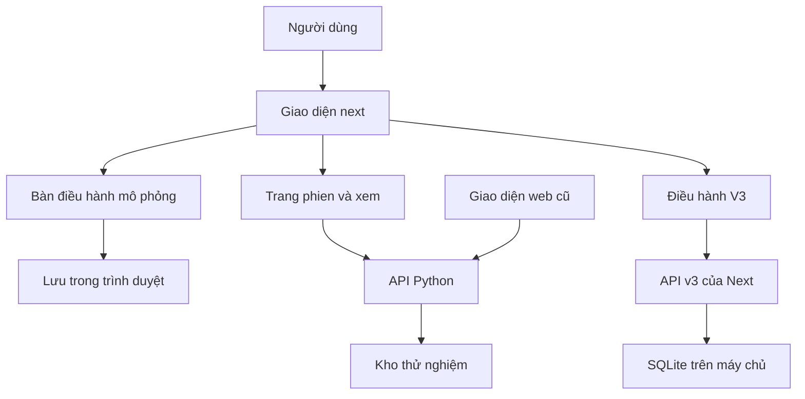
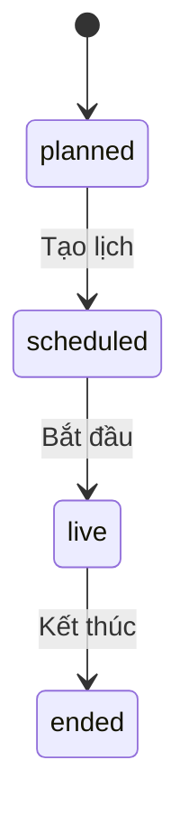
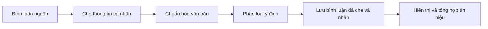

# Hiểu LiveLift để tự tin đọc code và thuyết trình

> **Bản 1 — dành cho người đã biết code ở mức vừa phải.**
>
> Đối chiếu mã nguồn tại commit `fc7abc5`, branch `Lamng`, ngày 19/10/2026. Tên thư mục dự án là `AISC2026_LIVEFIT`, còn tên sản phẩm trong code là **LiveLift**.
>
> Đây là tài liệu giải thích từ việc đọc code và tài liệu trong repo. Các ví dụ số được ghi rõ là minh họa; các số benchmark có nguồn và thời điểm. Chưa chạy lại ứng dụng, bộ test hay kết nối tài khoản nền tảng trong lần biên soạn này.

## Cách đọc để không bị ngợp

Đừng bắt đầu bằng việc nhớ tên tất cả file. Trước tiên, hãy trả lời được: **ai dùng, muốn làm gì, dữ liệu đi đâu, máy tính quyết định gì, cuối cùng kết luận được gì?** Sau đó mới lần theo code.

| Bạn có bao nhiêu thời gian? | Đọc phần nào? | Mục tiêu |
|---|---|---|
| 20 phút | 1–4, 11, 19 | Nắm câu chuyện và tránh nói sai khi giới thiệu |
| 1–2 giờ | 1–14, 18–20 | Giải thích được toàn bộ các luồng chính |
| Một buổi học | Toàn bộ bản này, mở các file được dẫn | Tự lần theo một phiên live từ đầu đến cuối |
| Chuẩn bị phản biện kỹ thuật | [Bản 2](02-GIAI-PHAU-KY-THUAT.md) | Hiểu thiết kế thống kê, giao dịch dữ liệu và giới hạn triển khai |

### Mục lục

1. [Dự án giải quyết vấn đề gì?](#p01)
2. [Ba luồng trong cùng một repo](#p02)
3. [Công nghệ dùng để làm gì?](#p03)
4. [Một phiên bán áo xuyên suốt](#p04)
5. [Lịch BẬT/TẮT được tạo như thế nào?](#p05)
6. [Máy chọn sản phẩm để ghim ra sao?](#p06)
7. [Bình luận đi từ màn hình đến mô hình như thế nào?](#p07)
8. [Lượt bấm và lượng người xem được đo ra sao?](#p08)
9. [Phòng xem thử có người tham gia](#p09)
10. [Từ dữ liệu đến kết quả thống kê](#p10)
11. [Chữ AI trong dự án thực sự nghĩa là gì?](#p11)
12. [Hệ thống điều hành kịch bản V3](#p12)
13. [TikTok, Shopee và các nguồn dữ liệu](#p13)
14. [Dữ liệu được cất ở đâu?](#p14)
15. [Cây thư mục và cách đọc code](#p15)
16. [Khởi động và triển khai](#p16)
17. [Đọc README, kế hoạch và benchmark cho đúng](#p17)
18. [Lộ trình tự học và ý tưởng phát triển](#p18)
19. [Kịch bản thuyết trình và câu hỏi phản biện](#p19)
20. [Từ điển dễ hiểu và bảng tự kiểm tra](#p20)

<a id="p01"></a>
## 1. Dự án giải quyết vấn đề gì?

Hãy tưởng tượng một shop đang livestream. Người dẫn giới thiệu áo, người xem hỏi giá và size, nhân viên thay đổi sản phẩm được ghim, rồi xem lượt bấm có tăng không.

Vấn đề là: **lượt bấm tăng chưa chắc do cách ghim tốt hơn**. Có thể đúng lúc đó người xem đông hơn, sản phẩm hấp dẫn hơn, người dẫn tung ưu đãi, hoặc nền tảng đẩy thêm lưu lượng.

LiveLift có một lõi thử nghiệm nhằm trả lời câu hỏi cụ thể:

> Khi bật chính sách gợi ý/ghim sản phẩm của hệ thống, số lượt bấm hợp lệ trên cùng một lượng thời gian xem có tốt hơn cách vận hành đối chứng không?

Repo đồng thời phát triển công cụ giúp đội vận hành chuẩn bị kịch bản, theo dõi buổi live bị trễ, cân nhắc phương án xử lý và tổng kết cho buổi sau. Đây là hướng sản phẩm điều hành, có phần code riêng với hệ thống thử nghiệm.

### Ba câu cần nhớ

1. **Theo dõi:** chuyện gì đang diễn ra trong phòng live?
2. **Hỗ trợ vận hành:** nên làm gì tiếp theo, khi nào cần đổi kế hoạch?
3. **Đo tác động:** thay đổi đó có tạo ra khác biệt đáng tin hay chỉ là dao động tình cờ?

Ba câu này liên quan với nhau, nhưng không phải cùng một bài toán. Biểu đồ đẹp trả lời câu 1; gợi ý hữu ích trả lời câu 2; thiết kế thử nghiệm và phân tích mới phục vụ câu 3.

Nguồn gốc câu chuyện: [README](../../README.md), [đề cương thử nghiệm](../../PREREGISTRATION.md), [định nghĩa sản phẩm V3](../research/codex-gap-study/12_FINAL_PRODUCT_DEFINITION.md).

<a id="p02"></a>
## 2. Ba luồng trong cùng một repo

Đây là phần dễ nhầm nhất. Mở được một giao diện có số liệu chạy **không đồng nghĩa** giao diện đó đang kết nối phòng live thật hoặc đang chạy bộ phân tích Python.

| Luồng | Mở ở đâu trong `next/`? | Công việc chính | Dữ liệu chính |
|---|---|---|---|
| Bàn điều hành mô phỏng | `/`, `/desk/[liveId]` | Trình diễn trải nghiệm theo dõi và gợi ý trong buổi live | Mô phỏng trong trình duyệt, lưu cục bộ |
| Thử nghiệm LiveLift | `/phien`, `/phien/[sessionId]`, trang người dẫn và tổng kết; người xem vào `/xem/[code]` | Tạo lịch BẬT/TẮT, thu sự kiện, đo chênh lệch | API Python, kho dữ liệu Python |
| Điều hành V3 | `/live/new`, `/live/[sessionId]/prepare`, `operate`, `review`, `wrap`, `lab` | Lập kịch bản, điều hành, xử lý trễ, tổng kết | Mô hình TypeScript; chế độ thật dùng máy chủ và SQLite |

Ngoài ra còn có **`web/`**, giao diện Next.js cũ. README và Docker Compose ở gốc vẫn dẫn tới giao diện này trong một số quy trình.



**Cách nói khi thuyết trình:** “Trong repo hiện có nhiều luồng phát triển. Em sẽ trình bày rõ luồng đang demo và nguồn dữ liệu của nó.” Sau đó chọn một luồng làm câu chuyện chính.

Để hiểu thử nghiệm, nên vào `/phien`. Để giới thiệu điều hành kịch bản, chọn V3. Có thể trình bày cả hai, nhưng phải nói rõ khi chuyển phần.

Đọc thêm: [kiến trúc nối Next với API](../kien-truc/hop-nhat-next-api.md), [trang chủ](../../next/src/app/page.tsx), [client của trang thử nghiệm](../../next/src/lib/livelift-api/client.ts), [bộ xử lý nghiệp vụ V3](../../next/src/lib/domain/engine.ts).

<a id="p03"></a>
## 3. Công nghệ dùng để làm gì?

### 3.1. Phần người dùng nhìn thấy

**React** chia màn hình thành những phần nhỏ: danh sách sản phẩm, thẻ gợi ý, đồng hồ, bảng tổng kết. Khi dữ liệu đổi, phần tương ứng được vẽ lại.

**Next.js** tổ chức các trang, đường dẫn và một số API chạy phía máy chủ. Vì vậy trong `next/` có cả code giao diện lẫn code máy chủ; không thể coi cả thư mục này chỉ là “frontend”.

**TypeScript** bổ sung mô tả kiểu dữ liệu: ví dụ trạng thái phiên phải thuộc một tập xác định. Nó giúp phát hiện nhiều lỗi khi viết/build code, nhưng không bảo đảm dữ liệu nhận từ mạng luôn đúng.

**Zod** kiểm tra dữ liệu thực sự ở lúc chạy. Ví dụ server trả thiếu trường bắt buộc thì client có thể từ chối thay vì hiển thị nhầm.

**Tailwind/CSS** lo hình thức: màu sắc, khoảng cách, bố cục, khả năng hiển thị trên nhiều kích thước màn hình.

### 3.2. Phần thử nghiệm và xử lý số liệu

**Python** chứa phần tạo lịch, xử lý bình luận, đo lượt bấm và phân tích thống kê.

**FastAPI** mở các địa chỉ như `/sessions` để giao diện gửi yêu cầu. **Uvicorn** là chương trình chạy ứng dụng FastAPI và nhận kết nối mạng.

**Pydantic** kiểm tra dữ liệu vào/ra phía Python. **NumPy, pandas, SciPy** xử lý mảng số, bảng dữ liệu và phép tính thống kê.

**scikit-learn** chạy mô hình phân loại ý định bình luận. Đây là mô hình nhỏ đã được huấn luyện; không cần gọi ChatGPT mỗi khi có bình luận.

### 3.3. Phần lưu trữ và triển khai

| Thành phần | Hiểu đơn giản | Dùng ở đâu? |
|---|---|---|
| PostgreSQL/TimescaleDB | Kho dữ liệu có thể lưu lâu dài, phù hợp nhiều sự kiện theo thời gian | Hệ thống thử nghiệm Python khi chọn backend PostgreSQL |
| Bộ nhớ + file snapshot | Giữ dữ liệu trong tiến trình, định kỳ chụp ra file | Chế độ Python dùng bộ nhớ |
| SQLite | Cơ sở dữ liệu nằm trong file, có giao dịch | Điều hành V3 và các kho bằng chứng/đăng nhập nền tảng riêng |
| `localStorage` | Kho nhỏ trong trình duyệt | Một số chế độ demo/cục bộ |
| Docker Compose | Khởi chạy nhóm dịch vụ theo cấu hình | Bộ triển khai ở gốc repo |
| Caddy | Nhận truy cập ngoài, chuyển đúng dịch vụ; có cấu hình HTTPS | Triển khai và phòng xem công khai |
| Redis | Dịch vụ được khai báo trong cấu hình | Chưa nên suy ra mọi cập nhật đang dùng Redis; bộ phát sự kiện Python hiện dùng hàng đợi trong tiến trình |

Phiên bản tại snapshot này: `next/` dùng Next **16.3.8**, React **19.3.0**; `web/` còn ở dòng Next **14**, React **18**. Không lấy hướng dẫn chạy của một thư mục áp dụng nguyên xi cho thư mục còn lại.

Nguồn: [pyproject.toml](../../pyproject.toml), [next/package.json](../../next/package.json), [web/package.json](../../web/package.json), [Docker Compose](../../docker-compose.yml).

<a id="p04"></a>
## 4. Một phiên bán áo xuyên suốt

Ta dùng một ví dụ **minh họa**, không phải kết quả kinh doanh của dự án:

- Shop có áo A, áo B, áo C với giá và tồn kho khác nhau.
- Buổi live dự kiến 90 phút.
- Đội muốn biết chính sách ghim của LiveLift có cải thiện lượt bấm không.

### Bước 1 — Khai báo sản phẩm và phiên

Giao diện gửi thông tin sản phẩm và phiên tới API. API kiểm tra dữ liệu rồi lưu. Mỗi đối tượng có mã định danh riêng để tránh nhầm hai sản phẩm cùng tên.

Phiên Python đi qua các trạng thái cơ bản:



Ngoài ra có trạng thái `cancelled` cho luồng hủy. Hãy nhớ **“đã tạo phiên” khác “đang live”**. Tạo dữ liệu xong không có nghĩa mọi hành động được phép chạy ngay.

### Bước 2 — Bốc thăm lịch trước buổi live

Hệ thống chia buổi live thành các khối thời gian, rồi quyết định khối nào BẬT chính sách và khối nào TẮT. Nó lưu lịch và thông tin cần để tái tạo lần bốc thăm.

### Bước 3 — Bắt đầu nhận dữ liệu

Tùy chế độ, dữ liệu đến từ bộ mô phỏng, phòng xem thử, nguồn nền tảng được cấu hình hoặc bản phát lại. Các nguồn này có giá trị chứng minh khác nhau.

Dữ liệu quan trọng gồm bình luận, lượng người xem theo thời gian, lượt bấm, đơn hàng nếu có, hành động ghim và lịch phân nhóm.

### Bước 4 — Đưa ra và ghi nhận hành động

Trong khối BẬT, hệ thống xem sản phẩm nào đủ điều kiện, tính điểm và chọn hành động. Hành động được ghi lại để sau này biết **lịch bảo bật** và **hệ thống có thực hiện không**.

Một chi tiết quan trọng: hàm thực thi Python hiện ghi hành động và trạng thái ghim trong hệ thống. Bản thân hàm này **không gọi API bên ngoài để ghim trên TikTok/Shopee thật**.

### Bước 5 — Theo dõi trong lúc live

Người vận hành xem thông tin phiên. Người dẫn có một chế độ hiển thị gọn hơn, chủ yếu sản phẩm đang ghim, giá, tồn kho và thời gian đã chạy.

Việc có màn hình người dẫn gọn hơn giúp giảm thông tin gây nhiễu. Nhưng chỉ chọn `role=host` trong API chưa phải một hệ thống phân quyền tài khoản hoàn chỉnh.

### Bước 6 — Kết thúc và tổng kết

Các khối có đủ dữ liệu được chuyển thành bảng đo. Hệ thống so sánh BẬT với TẮT, đánh giá mức bất định và trả về báo cáo nếu đủ điều kiện.

Kết luận có thể là tích cực, tiêu cực hoặc chưa rõ. **“Chưa rõ” là một kết quả hợp lệ**, nhất là khi lượng dữ liệu ít.

Các điểm đọc chính: [sessions.py](../../src/livelift/api/routes/sessions.py), [service.py](../../src/livelift/api/service.py), [actions.py](../../src/livelift/api/routes/actions.py), [reports.py](../../src/livelift/api/routes/reports.py).

<a id="p05"></a>
## 5. Lịch BẬT/TẮT được tạo như thế nào?

### 5.1. Tại sao không chia người xem thành hai nhóm?

Trong cùng một phòng live, mọi người thường thấy cùng sản phẩm được ghim. Nếu một nửa người xem thuộc nhóm A, một nửa thuộc nhóm B nhưng cả hai nhìn cùng một nội dung, việc chia nhóm sẽ không còn đúng ý nghĩa.

LiveLift dùng **switchback**, hiểu là **thay đổi chế độ thử nghiệm theo từng khoảng thời gian trong cùng phòng**.

Ví dụ minh họa:

```text
Thời gian  →   khối 1   khối 2   khối 3   khối 4   khối 5 ...
Phân nhóm  →    TẮT      BẬT      BẬT      TẮT      BẬT  ...
```

Không cần BẬT–TẮT xen kẽ tuyệt đối. Code còn quan tâm đến việc có các cặp BẬT–BẬT và TẮT–TẮT để phục vụ cấu trúc thiết kế.

### 5.2. Vì sao không để nửa đầu TẮT, nửa sau BẬT?

Nửa sau có thể tự nhiên đông khách hơn hoặc đúng lúc tung deal. Khi đó khác biệt có thể do thời điểm. Bộ tạo lịch cố gắng có cả hai nhóm trong giai đoạn đầu, giữa và cuối buổi.

Thiết kế mặc định dùng khối danh nghĩa 5 phút, khối đầu/cuối dài hơn, ranh giới có thể lệch một chút. Với 90 phút và cấu hình mặc định, lịch có 16 khối đo; đừng mặc định 90/5 luôn là 18 khối trong code này.

### 5.3. `seed` và `design_hash` để làm gì?

- **Seed:** số khởi đầu cho bộ sinh ngẫu nhiên. Cùng tham số và seed thì có thể tạo lại cùng lịch.
- **Design hash:** dấu vân tay tính từ thiết kế và seed. Nó giúp đối chiếu đang nói về thiết kế nào.
- **Assignment events:** lịch sử việc phân nhóm được lưu để kiểm tra lại.

Hash không tự biến cơ sở dữ liệu thành nơi không ai sửa được. Nó là công cụ truy vết, không phải bằng chứng chống mọi sửa đổi từ người có quyền quản trị.

### 5.4. Ba khái niệm thời gian hay bị trộn

| Khái niệm | Hiểu đơn giản |
|---|---|
| Độ dài khối | Khoảng thời gian giữ một nhãn BẬT/TẮT |
| Washout | Khoảng được thiết kế để giảm ảnh hưởng còn sót; mặc định thiết kế hiện là 0 phút |
| Burn-in khi phân tích | Bỏ phần đầu khối khỏi cửa sổ đo; luồng phân tích hiện thường dùng 60 giây |

Bỏ 60 giây đầu không bảo đảm xóa hết ảnh hưởng từ khối trước. Người vừa thấy sản phẩm có thể vài phút sau mới bấm.

Nguồn: [outer.py](../../src/livelift/core/assigner/outer.py), [features.py](../../src/livelift/core/features.py), [PREREGISTRATION](../../PREREGISTRATION.md).

<a id="p06"></a>
## 6. Máy chọn sản phẩm để ghim ra sao?

Hãy tách hai lần quyết định:

1. **Vòng ngoài:** lúc này có được dùng chính sách LiveLift không? Do lịch BẬT/TẮT quyết định.
2. **Vòng trong:** nếu được dùng, chọn sản phẩm nào? Do bộ chọn ứng viên quyết định.

### 6.1. Đầu tiên là lọc điều kiện

Không nên gợi ý một sản phẩm đã gần hết hàng. Bộ dựng ứng viên xét tồn kho, tốc độ bán và phạm vi sản phẩm của phòng. Với phòng thử, sản phẩm còn phải thuộc đúng phòng.

### 6.2. Sau đó mới tính điểm

Code xem sản phẩm đã được ghim trong bao nhiêu thời gian xem và nhận bao nhiêu lượt bấm. Nó tạo ra:

- Một ước lượng “sản phẩm này đang thu hút lượt bấm ở mức nào”.
- Một khoảng thể hiện “ước lượng này còn chưa chắc đến đâu”.

Sản phẩm mới chưa có dữ liệu không bị mặc định là vô dụng. Nó có điểm khởi đầu chung và còn cơ hội được thử.

### 6.3. Nếu hai sản phẩm gần nhau thì sao?

Nếu khoảng ước lượng của nhiều sản phẩm còn chồng nhau, code có thể chọn ngẫu nhiên đều giữa các ứng viên đó. Nó ghi luôn xác suất chọn.

Ví dụ: A và B đều chưa có bằng chứng đủ mạnh để tách biệt, mỗi sản phẩm có thể có xác suất 1/2. Khi chỉ còn một ứng viên vượt trội theo tiêu chí đó, xác suất chọn là 1.

Đây là cách vừa dùng dữ liệu hiện có, vừa tiếp tục học về những lựa chọn chưa rõ.

### 6.4. Điều gì xảy ra trong khối TẮT?

Hệ thống không tự tạo hành động ghim của chính sách thử nghiệm trong khối TẮT. Tuy nhiên, sản phẩm ghim từ trước có thể vẫn còn trong trạng thái bàn điều hành; không được diễn giải TẮT thành “chắc chắn màn hình trống, không ghim gì”.

Phòng xem thử có logic riêng để hiện ghim gắn với khối hiện tại. Phải phân biệt giao diện người xem thử với trạng thái ghim chung của phiên.

### 6.5. Một giới hạn rất đáng hiểu

Điểm xếp hạng sản phẩm hiện dùng dữ liệu bấm theo cách riêng; số liệu kết luận thử nghiệm dùng **lượt bấm hợp lệ** và cửa sổ đo riêng. Điểm gợi ý không phải “tác động nhân quả đã chứng minh” của từng sản phẩm.

Nguồn: [cards.py](../../src/livelift/api/cards.py), [ung_vien.py](../../src/livelift/api/ung_vien.py), [inner.py](../../src/livelift/core/assigner/inner.py), [autopilot.py](../../src/livelift/api/autopilot.py).

<a id="p07"></a>
## 7. Bình luận đi từ màn hình đến mô hình như thế nào?

Ví dụ một người viết: “Áo này bao nhiêu, gọi em 09…”.



### 7.1. Che thông tin cá nhân trước

Bộ lọc tìm các mẫu như số điện thoại, email, tài khoản ngân hàng, địa chỉ hoặc mã đơn rồi thay bằng nhãn. Ví dụ minh họa: “gọi em [SĐT]”. Có xử lý chữ/số tiếng Việt và một số kiểu viết né mẫu thông thường.

Mục tiêu là giảm việc lưu hoặc truyền dữ liệu không cần thiết. Bộ lọc dựa trên quy tắc nên vẫn có thể bỏ sót hoặc che nhầm; không nên tuyên bố nó nhận ra tuyệt đối mọi thông tin cá nhân.

### 7.2. Biến câu chữ thành các con số

Mô hình không đọc câu theo cách con người. Nó lấy các từ và những cụm ký tự ngắn, rồi tính mức nổi bật của chúng. Kỹ thuật này gọi là **TF-IDF**.

Ví dụ các cụm liên quan “giá”, “bao nhiêu” thường giúp nhận biết hỏi giá. Cụm ký tự hỗ trợ một phần khi người xem viết tắt hoặc sai chính tả.

### 7.3. Dự đoán nhóm ý định

Mô hình chính là **Logistic Regression**: một bộ phân loại học trọng số cho các dấu hiệu văn bản. Phiên bản mặc định v1 có sáu nhóm:

| Nhãn trong code | Nghĩa |
|---|---|
| `hoi_gia` | Hỏi giá |
| `hoi_size` | Hỏi kích cỡ |
| `che_dat` | Chê giá cao |
| `chot_don` | Bày tỏ ý định đặt hàng |
| `van_chuyen` | Hỏi giao hàng |
| `khac` | Nội dung khác hoặc chưa đủ tự tin |

Một bình luận “chốt đơn” chỉ là **ý định trong lời nói**, không phải bằng chứng đã thanh toán.

### 7.4. Nếu mô hình không chắc hoặc không tải được?

Nếu xác suất cao nhất dưới ngưỡng hiện tại 0,45, nhãn được đưa về `khac`. Nếu không tải/chạy được mô hình, có phương án dự phòng dựa trên từ khóa. Trang sức khỏe hệ thống có thông tin để biết đang chạy mô hình hay phương án dự phòng.

Repo có v2 với 11 nhóm và dữ liệu huấn luyện mở rộng. Nhưng **v2 chưa phải mặc định**; cần cấu hình `LIVELIFT_INTENT_MODEL=v2` để chọn.

### 7.5. Không được nói “AI chính xác 87% với khách hàng thật”

Con số khoảng 0,870 được ghi trong tài liệu cũ thuộc phép đánh giá trên 320 mẫu được soạn bằng AI. Nó không tự chứng minh chất lượng trên bình luận tự nhiên của mọi shop. Bản v2 cũng có giới hạn nhãn tham chiếu do AI tạo.

Nguồn: [lọc PII](../../src/livelift/ingest/pii/filter.py), [huấn luyện](../../src/livelift/nlp/train_intent.py), [chạy mô hình](../../src/livelift/nlp/intent.py), [FACT-SHEET](../competition/FACT-SHEET.md).

<a id="p08"></a>
## 8. Lượt bấm và lượng người xem được đo ra sao?

### 8.1. Vì sao dùng link trung gian?

Người xem bấm link có dạng `/r/{code}`. Server tìm đường dẫn sản phẩm, ghi sự kiện bấm rồi chuyển người xem sang trang đích bằng phản hồi HTTP 302.

```text
Người xem → link LiveLift → ghi lượt bấm → chuyển tới trang sản phẩm
```

Nếu đã tìm được trang đích mà bước ghi sự kiện gặp lỗi, code cố gắng vẫn chuyển người xem. Nhưng nếu kho dữ liệu không trả được chính link đích thì không thể bảo đảm chuyển hướng.

### 8.2. Có phải cứ request là một lượt bấm thật?

Không. Robot, tính năng tải trước của trình duyệt hoặc thao tác bấm liên tục có thể làm phồng số liệu. Code đánh dấu các lượt không hợp lệ theo năm nhóm quy tắc:

1. Nhận diện một số tác nhân tự động qua thông tin trình duyệt.
2. Loại yêu cầu tải trước/xem trước.
3. Chỉ tính phương thức GET là lượt bấm.
4. Hạn chế bấm lặp quá gần nhau; mặc định cửa sổ 10 giây.
5. Giới hạn mặc định 5 lượt được tính cho cùng dấu nhận diện, link và khối.

Các lượt không hợp lệ được giữ cùng lý do để kiểm tra; không âm thầm xóa khỏi lịch sử. Quy tắc không được nhìn BẬT/TẮT để quyết định hợp lệ, vì làm vậy có thể thiên vị kết quả.

### 8.3. “1.000 giây-người xem” là gì?

Nếu 10 người cùng xem trong 100 giây thì tổng thời gian xem là:

```text
10 người × 100 giây = 1.000 giây-người xem
```

Nếu cùng khoảng đó có 4 lượt bấm hợp lệ, chỉ số là 4 lượt bấm/1.000 giây-người xem.

Lượng người xem thay đổi liên tục nên code cộng các đoạn thời gian với số người xem tương ứng. Ví dụ minh họa:

```text
30 giây đầu: 20 người → 600 giây-người xem
30 giây sau: 30 người → 900 giây-người xem
Tổng:                  1.500 giây-người xem
3 lượt bấm hợp lệ → 3 / 1.500 × 1.000 = 2
```

**Đây không phải CTR thông thường tính theo số lượt hiển thị.** Khi trình bày, đọc đầy đủ đơn vị ít nhất lần đầu.

### 8.4. Vì sao không chỉ so tổng lượt bấm?

Khối đông người thường có nhiều lượt bấm hơn dù cách vận hành không tốt hơn. Chia cho lượng thời gian xem giúp đưa hai khối về cùng một thước đo.

Nhưng nếu chính can thiệp làm tăng người xem, tỷ lệ này không phản ánh toàn bộ tác động lên tổng lưu lượng hoặc doanh thu. Repo có các phân tích bổ sung để xem vấn đề đó; đừng dùng một chỉ số thay cho mọi kết luận kinh doanh.

Nguồn: [redirect.py](../../src/livelift/api/routes/redirect.py), [click_validity.py](../../src/livelift/core/click_validity.py), [features.py](../../src/livelift/core/features.py).

<a id="p09"></a>
## 9. Phòng xem thử có người tham gia

Trang `/xem/[code]` giúp tổ chức thử nghiệm có người thao tác trên giao diện do nhóm kiểm soát.

Người tham gia đồng ý trước, rồi có thể xem sản phẩm, bấm, thêm giỏ, mua thử và bình luận. Trình duyệt gửi nhịp hoạt động để server ước lượng lượng người đang tham gia.

### Điều gì là thật trong phòng thử?

- Có thể có người thật đọc, bấm và bình luận.
- Các sự kiện đó được đưa vào luồng thu thập thật của ứng dụng.
- **“Mua” trong phòng thử tạo đơn giả lập**, không phải giao dịch thanh toán với nền tảng thương mại.
- Người tham gia phòng thử không đại diện tự động cho khách hàng tự nhiên của shop.

### Đồng ý và rút lui hoạt động ra sao?

API yêu cầu sự đồng ý. Khi rút lui, hệ thống xóa các sự kiện liên quan và cập nhật lại số người xem. Nó vẫn giữ dấu nhận diện đã băm của yêu cầu rút lui để chặn sự kiện tiếp theo; vì vậy không nên nói “không còn bất kỳ dấu vết nào”.

Mã sự kiện giúp nhận ra một yêu cầu gửi lại do mạng chập chờn, tránh tính cùng thao tác hai lần.

### Vì sao cần phòng thử?

Đây là cầu nối giữa mô phỏng hoàn toàn và triển khai với khách hàng thật. Ta kiểm tra được người dùng có hiểu màn hình không, bấm có được ghi không và toàn bộ chuỗi báo cáo có hoạt động theo thiết kế không. Nó vẫn chưa thay thế một nghiên cứu thương mại ngoài thực tế.

Nguồn: [xem.py](../../src/livelift/api/routes/xem.py), [XemRoom](../../next/src/components/phien/XemRoom.tsx), [kịch bản mở phòng](../../scripts/mo_phong_xem.py).

<a id="p10"></a>
## 10. Từ dữ liệu đến kết quả thống kê

### 10.1. Mỗi khối thời gian trở thành một dòng dữ liệu

Ví dụ minh họa:

| Khối | Nhóm | Giây-người xem trong cửa sổ đo | Bấm hợp lệ | Bấm/1.000 giây-người xem |
|---|---|---:|---:|---:|
| 1 | TẮT | 10.000 | 20 | 2,0 |
| 2 | BẬT | 12.000 | 36 | 3,0 |
| 3 | BẬT | 8.000 | 20 | 2,5 |
| 4 | TẮT | 10.000 | 22 | 2,2 |

Trung bình BẬT = 2,75; trung bình TẮT = 2,10; chênh lệch = **+0,65 lượt bấm/1.000 giây-người xem**.

Đây chỉ là phép tính minh họa. Bốn khối không tự bảo đảm có đủ bằng chứng để kết luận.

### 10.2. Khối chưa phát sóng không phải khối có kết quả bằng 0

Nếu lịch có 90 phút nhưng phiên dừng sớm, khối chưa diễn ra không được xem là “có người xem nhưng không ai bấm”. Tương tự, thiếu dữ liệu lượng người xem không nên tự biến thành tỷ lệ 0.

Code đánh dấu khối nào đủ điều kiện đo, loại phần đầu khối theo cấu hình, và dùng cùng khoảng thời gian cho cả số bấm lẫn lượng thời gian xem.

### 10.3. Chênh lệch dương đã đủ chưa?

Chưa. Một lần bốc thăm có thể vô tình đưa các khối thuận lợi vào BẬT. Bộ kiểm định hỏi:

> Nếu chính sách không có tác dụng, những lịch bốc thăm khác theo cùng quy tắc có thường tạo ra chênh lệch lớn như đang thấy không?

Máy sinh nhiều lịch hợp lệ, tính lại mức chênh lệch và so sánh. Cách này gọi là **suy luận dựa trên ngẫu nhiên hóa**.

Không được tráo nhãn tùy tiện bỏ qua quy tắc lịch ban đầu. Code tái sử dụng cấu trúc thiết kế khi sinh các lịch đối chiếu.

### 10.4. Hiểu p-value và khoảng tin cậy

- **p-value:** mức hiếm của kết quả ít nhất cực đoan như đã thấy, dưới giả thuyết và cơ chế bốc thăm dùng trong kiểm định.
- Nó **không** có nghĩa “xác suất sản phẩm thành công” hoặc “xác suất AI đúng”.
- **Khoảng tin cậy:** một cách biểu diễn mức bất định của ước lượng. Khoảng rộng nghĩa là còn nhiều giá trị tác động tương thích với dữ liệu và giả định phân tích.

Ví dụ minh họa:

| Chênh lệch và khoảng | Diễn giải vừa sức |
|---|---|
| +0,6; khoảng [+0,2; +1,0] | Có bằng chứng theo hướng tăng trong phạm vi phép phân tích |
| +0,6; khoảng [−0,4; +1,6] | Ước lượng đang dương nhưng chưa phân biệt rõ tăng, không đổi hay giảm |
| −0,6; khoảng [−1,0; −0,2] | Có bằng chứng theo hướng giảm |

Code tạo khoảng bằng cách kiểm định nhiều mức tác động giả định. Phương pháp này có giả định riêng; bản kỹ thuật giải thích kỹ hơn.

### 10.5. Vì sao có lúc không hiện kết luận?

Luồng báo cáo `/bao-cao` có các điều kiện như phiên chưa kết thúc, chưa đủ khối đo, mỗi nhóm chưa đủ khối, thiếu nguồn bấm hợp lệ, thời điểm khóa phân tích chưa tới hoặc khoảng ước lượng không hữu hạn. Tối thiểu cơ bản là 4 khối đo và ít nhất 2 khối mỗi nhóm; đạt ngưỡng này vẫn chưa bảo đảm kết luận mạnh.

Phiên demo có ngoại lệ phục vụ trình diễn. Endpoint cũ `/report` không có toàn bộ các khóa như `/bao-cao`, nên không được tuyên bố mọi đường truy cập đều chống việc xem kết quả giữa phiên.

### 10.6. Ba giới hạn phải nhớ

1. **Ảnh hưởng kéo dài:** người xem chịu tác động ở khối trước nhưng bấm ở khối sau.
2. **Thực hiện không đúng lịch:** hệ thống được phân BẬT nhưng chưa thực sự ghim.
3. **Tác động lên mẫu số:** chính sách có thể làm người ở lại lâu hơn; tỷ lệ bấm và tổng số bấm có thể kể hai câu chuyện khác nhau.

Nguồn: [estimators.py](../../src/livelift/analysis/estimators.py), [quality.py](../../src/livelift/core/quality.py), [reports.py](../../src/livelift/api/routes/reports.py), [đánh giá mô phỏng phòng live](../benchmarks/liveroom-kiem-dinh.md).

<a id="p11"></a>
## 11. Chữ AI trong dự án thực sự nghĩa là gì?

| Thành phần | Cách thực hiện | Có phải gọi mô hình ngôn ngữ lớn không? |
|---|---|---|
| Phân loại bình luận | TF-IDF + Logistic Regression, có dự phòng từ khóa | Không |
| Chọn ứng viên sản phẩm | Ước lượng thống kê và chọn theo quy tắc/xác suất | Không |
| Bốc thăm và phân tích thử nghiệm | Thuật toán và phép kiểm định thống kê | Không |
| Tóm tắt báo cáo Python | Mẫu câu xác định từ số liệu | Không |
| Copilot V3 tùy chọn | Gửi ngữ cảnh đã chuẩn bị tới nhà cung cấp AI, kiểm tra đầu ra | Có, nếu cấu hình |

Điểm mạnh cần giải thích là cách các thành phần phối hợp, không phải gọi toàn bộ code là “AI”.

### Copilot V3 được phép làm gì?

Nó diễn đạt và hỗ trợ cân nhắc những phương án hợp lệ từ hệ thống. Đầu ra được kiểm tra cấu trúc, căn cứ dữ liệu và các con số trước khi dùng. Người vận hành vẫn cần chấp nhận hành động; câu trả lời của AI không trực tiếp ghi đè lịch điều hành.

Nếu chưa cấu hình dịch vụ AI, không gọi được hoặc đầu ra không hợp lệ, ứng dụng có trạng thái lỗi/không sẵn sàng tương ứng. Phần tính toán thử nghiệm Python và mô hình bình luận cục bộ không cần API key của LLM.

Nguồn: [narrate.py](../../src/livelift/analysis/narrate.py), [AI service V3](../../next/src/lib/server/ai/service.ts), [nhà cung cấp AI](../../next/src/lib/server/ai/providers.ts).

<a id="p12"></a>
## 12. Hệ thống điều hành kịch bản V3

Ta chuyển sang một câu chuyện khác: đội livestream có kế hoạch 60 phút, gồm mở đầu, giới thiệu sản phẩm, giải đáp và chốt buổi. Một đoạn bị kéo dài; đội cần quyết định xử lý thế nào.

### 12.1. Chuẩn bị

Người dùng lập các đoạn của buổi live: nội dung, thời lượng, sản phẩm liên quan và các ràng buộc. Có đoạn bắt buộc, đoạn có thể rút ngắn hoặc bỏ qua.

Khi bắt đầu, hệ thống giữ một bản kế hoạch gốc để sau này so sánh. Kế hoạch đang điều chỉnh và kế hoạch ban đầu là hai thứ khác nhau.

### 12.2. Điều hành

Người vận hành bắt đầu/kết thúc đoạn, ghi nhận tình huống, xem dự báo kết thúc. Nếu chưa đủ thông tin, hệ thống có thể chỉ đưa ra mốc sớm nhất có cơ sở thay vì bịa một giờ kết thúc chính xác.

### 12.3. Xử lý khi trễ

Ví dụ đoạn giới thiệu áo kéo dài thêm 5 phút. Hệ thống có thể dựng các phương án như rút ngắn một đoạn sau, bỏ một đoạn tùy chọn hoặc điều chỉnh mốc theo quy định.

Mỗi phương án được thử qua cùng bộ quy tắc nghiệp vụ trước khi cho người dùng chọn. Việc “xem trước phương án” không có nghĩa dữ liệu thật đã đổi.

### 12.4. Hai người cùng sửa thì sao?

Giả sử A và B cùng đang xem bản kế hoạch số 10. A sửa xong, máy chủ lên số 11. B gửi lệnh dựa trên số 10 thì bị báo xung đột để tải lại; code không âm thầm đè thay đổi của A.

Mỗi lệnh có mã riêng. Nếu A bấm một lần nhưng mạng gửi lại cùng lệnh, server có thể trả lại kết quả cũ thay vì thực hiện lần thứ hai.

### 12.5. Tổng kết và chuẩn bị buổi sau

Hệ thống đối chiếu kế hoạch gốc với diễn biến thật, giữ lịch sử điều chỉnh và cho chọn thay đổi phù hợp để chuyển sang kế hoạch buổi sau. Không nên mang nguyên lịch sử thời gian của buổi cũ sang buổi mới.

### 12.6. “Lúc đó đã biết gì?”

Một dữ liệu có thể mô tả sự kiện lúc 20:05 nhưng đến 20:20 mới được nhận. Khi đánh giá quyết định lúc 20:10, hệ thống không nên giả vờ người vận hành đã biết dữ liệu nhận lúc 20:20.

V3 phân biệt thời điểm sự kiện xảy ra và thời điểm được ghi nhận. Đây là chi tiết quan trọng để tổng kết công bằng.

Nguồn: [engine](../../next/src/lib/domain/engine.ts), [forecast](../../next/src/lib/domain/forecast.ts), [recovery](../../next/src/lib/domain/recovery.ts), [authority](../../next/src/lib/server/authority.ts), [asKnownThen](../../next/src/lib/domain/asKnownThen.ts), [nextLive](../../next/src/lib/domain/nextLive.ts).

<a id="p13"></a>
## 13. TikTok, Shopee và các nguồn dữ liệu

### 13.1. Có adapter không có nghĩa đã có kết nối thật đang chạy

Adapter là phần dịch dữ liệu của nguồn bên ngoài về dạng ứng dụng hiểu được. Ví dụ mỗi nền tảng trả bình luận khác cấu trúc, nhưng bên trong LiveLift đều cần thời gian, nội dung và mã sự kiện.

Repo có adapter YouTube, Facebook, Shopee; nhánh TikTok Shop và những nhánh phát lại/công cụ thu thập khác. Quyền truy cập, loại dữ liệu và mức chính thức khác nhau. Phải đọc cấu hình và tình trạng kết nối của phiên cụ thể mới biết đang nhận gì.

### 13.2. Đăng nhập TikTok chưa phải lấy toàn bộ dữ liệu TikTok LIVE

Phần Login Kit trong Next phục vụ kết nối tài khoản và thông tin hồ sơ theo quyền đã cấu hình. Nó không tự cấp quyền bình luận LIVE, ghim sản phẩm hay số liệu TikTok Shop.

Phần Live Intelligence dùng cấu hình và quyền riêng cho bằng chứng từ Shop/Creator. Trong code hiện tại, đọc bình luận thô, điều khiển ghim/bỏ ghim và giveaway nằm trong nhóm không hỗ trợ của lớp này.

### 13.3. Giao diện Shopee trong repo là gì?

`next/src/lib/platform/shopeeLive.ts` là mô hình mô phỏng nền tảng chạy trong bộ nhớ, không gọi mạng. Nó giúp thử trải nghiệm và quy tắc; không được trình diễn rồi nói là đang điều khiển Shopee thật.

Điều này tách biệt với adapter thu thập Shopee ở Python.

### 13.4. Bằng chứng nền tảng có thể đến muộn

V3 có phần nhập và đối chiếu dữ liệu nền tảng. Nó giữ nguồn, thời điểm nhận và phạm vi của số liệu. Một chỉ số từ nhà cung cấp được ghi là quan sát từ nhà cung cấp, không tự nâng thành bằng chứng đã được nền tảng xác nhận mọi mặt.

Nếu một khoảng số liệu nằm vắt qua hai đoạn kịch bản, code có thể ghi là không xác định được cách ghép. Nó không tự chia đôi doanh thu cho đẹp bảng. Thiếu số liệu là “chưa biết”, khác với 0.

Nguồn: [các nguồn Python](../../src/livelift/ingest/), [TikTok service](../../next/src/lib/server/tiktok/service.ts), [Live Intelligence provider](../../next/src/lib/server/liveIntelligence/provider.ts), [ghép bằng chứng](../../next/src/lib/domain/liveIntelligence.ts), [Shopee mô phỏng](../../next/src/lib/platform/shopeeLive.ts).

<a id="p14"></a>
## 14. Dữ liệu được cất ở đâu?

### 14.1. Không có một kho chung cho toàn bộ repo

| Luồng | Nơi giữ dữ liệu | Điều cần hiểu |
|---|---|---|
| Python dùng memory | RAM và snapshot JSON nếu bật | Có thể mất phần chưa chụp khi tiến trình dừng đột ngột |
| Python dùng PostgreSQL | Các bảng phiên, khối, bình luận, tick, click, đơn, sự kiện | Cần migration và database hoạt động |
| V3 thật | SQLite trên máy chủ | Có kiểm tra quyền, phiên bản dữ liệu và giao dịch |
| Kết nối/bằng chứng nền tảng V3 | Các SQLite riêng | Không đồng nhất với kho phiên Python |
| Demo/cục bộ trong Next | `localStorage` | Gắn với trình duyệt; xóa dữ liệu web có thể làm mất dữ liệu demo |

“Session” xuất hiện ở nhiều nơi nhưng không phải lúc nào cũng là cùng loại đối tượng. Session Python có lịch thử nghiệm; session V3 có các đoạn kịch bản điều hành.

### 14.2. Nếu mạng nguồn dữ liệu chập chờn?

Có hai đường thu thập cần phân biệt:

- Công cụ thu thập chạy riêng có thể thử gửi lại rồi lưu sự kiện đã che thông tin nhạy cảm xuống file hàng đợi để phát lại sau.
- Bộ thu thập chạy trong API dùng hàng đợi có giới hạn trong bộ nhớ và có bộ đếm sự kiện bị rơi khi quá tải.

Vì vậy không nên nói “mọi dữ liệu đều không bao giờ mất”. Thiết kế có cơ chế phục hồi, nhưng từng đường đi có giới hạn riêng.

### 14.3. Mở ra Internet cần hiểu đúng ranh giới

V3 có đăng nhập và phân quyền ở các API của nó. Cầu nối `/api/ll` sang Python hiện không tự dùng cùng lớp đăng nhập V3; nó chuyển tiếp các đường dẫn trong danh sách cho phép và có thể đính kèm token máy chủ.

Do đó, cấu hình public phục vụ phòng thử chủ đích chỉ mở những đường cần cho người xem. Không nên mở toàn bộ cổng Next ra ngoài rồi cho rằng cookie V3 bảo vệ mọi luồng trong ứng dụng.

Nguồn: [store.py](../../src/livelift/api/store.py), [runner.py](../../src/livelift/ingest/runner.py), [ingest_jobs.py](../../src/livelift/api/ingest_jobs.py), [V3 database](../../next/src/lib/server/database.ts), [cầu nối API](../../next/src/app/api/ll/[...path]/route.ts), [Caddy tunnel](../../docker/Caddyfile.tunnel).

<a id="p15"></a>
## 15. Cây thư mục và cách đọc code

```text
AISC2026_LIVEFIT/
├── src/livelift/          Phần Python
│   ├── api/              Nhận yêu cầu, điều phối phiên, quản lý kho
│   ├── core/             Lịch thử nghiệm, chỉ số, chất lượng dữ liệu
│   ├── analysis/         Ước lượng, kiểm định, độ nhạy, tóm tắt
│   ├── ingest/           Thu thập và che thông tin cá nhân
│   ├── nlp/              Mô hình bình luận, dữ liệu, huấn luyện
│   ├── sim/              Sinh phòng live giả lập để đánh giá
│   └── migrations/       Các bước tạo/cập nhật cấu trúc database
├── next/                 Giao diện mới + máy chủ V3 + cầu nối Python
│   └── src/
│       ├── app/          Trang và API theo đường dẫn
│       ├── components/   Các phần giao diện
│       ├── contracts/    Hợp đồng dữ liệu V3
│       └── lib/          Logic trình duyệt, nghiệp vụ, máy chủ
├── web/                  Giao diện cũ nối Python
├── tests/                Kiểm thử Python và các hành vi tích hợp
├── scripts/              Công cụ chạy, demo, dữ liệu, vận hành
├── docs/                 Kiến trúc, nghiên cứu, benchmark, thi cử
├── ops/                  Quy trình, cấu hình và vật liệu vận hành
├── docker/               Cấu hình ảnh/dịch vụ và chuyển tiếp mạng
├── README.md             Cửa vào dự án, có thông tin theo lịch sử
└── PREREGISTRATION.md    Thiết kế phân tích định trước
```

### Đọc một chức năng theo đường đi, không đọc ngẫu nhiên

Ví dụ muốn hiểu nút “bắt đầu phiên”:

1. Tìm giao diện gửi yêu cầu gì.
2. Mở client để biết URL và dữ liệu gửi.
3. Mở route máy chủ xử lý URL đó.
4. Xem điều kiện nào cho phép/từ chối.
5. Xem kho dữ liệu ghi gì.
6. Xem giao diện nhận trạng thái mới thế nào.

Đối với luồng thử nghiệm, chuỗi đọc gọn là:

```text
components/phien
→ lib/livelift-api/client.ts
→ app/api/ll/[...path]/route.ts
→ Python api/routes
→ service/core/analysis/store
→ dữ liệu trả về
→ màn hình
```

Đối với V3:

```text
components/ops
→ API v3
→ xác thực + RoomAuthority
→ domain/engine
→ giao dịch SQLite
→ trạng thái và biên nhận lệnh
```

<a id="p16"></a>
## 16. Khởi động và triển khai

Phần này giúp hiểu cách ghép dịch vụ. Các lệnh dưới đây chưa được chạy lại trong lần biên soạn; cần dùng môi trường và dữ liệu phù hợp của bạn.

### 16.1. Chạy luồng thử nghiệm mới trên máy cá nhân

Yêu cầu theo cấu hình repo: Python từ 3.11; Node đáp ứng `>=22.16 <23` hoặc `>=24` cho `next/`.

Từ thư mục gốc, chuẩn bị môi trường Python nếu chưa có:

```bash
python3 -m venv .venv
source .venv/bin/activate
python -m pip install -e ".[server,ml,dev]"
```

Terminal 1, chạy API cục bộ:

```bash
source .venv/bin/activate
export STORE_BACKEND=memory
uvicorn livelift.api.main:app --host 127.0.0.1 --port 8000 --timeout-keep-alive 75
```

Chế độ memory có thể khôi phục snapshot đã tồn tại; không mặc định dữ liệu sẽ trống. Muốn dùng PostgreSQL cần cấu hình kho và chạy migration theo hướng dẫn vận hành.

Terminal 2, chạy giao diện mới:

```bash
cd next
npm ci
LIVELIFT_API_BASE=http://127.0.0.1:8000 npm run dev
```

Mở `http://localhost:3130/phien`. API có tài liệu tương tác tại `http://127.0.0.1:8000/docs`.

Nếu Python đã cấu hình `INGEST_TOKEN`, cầu nối Next cần `LIVELIFT_API_TOKEN` tương ứng. Đây là biến phía server; không đưa token vào biến công khai `NEXT_PUBLIC_*`.

### 16.2. Vì sao mở trang chủ chưa đủ?

Trang `/` thuộc luồng bàn điều hành mô phỏng. Muốn xem việc Next gọi Python hãy vào `/phien`. Muốn dùng V3 thật cần cấu hình riêng về workspace, kho SQLite và tài khoản.

### 16.3. V3 thật cần chuẩn bị gì?

Cấu hình production của V3 yêu cầu mã phòng, UUID workspace, đường dẫn SQLite tuyệt đối, địa chỉ ứng dụng HTTPS và nơi lưu backup. CLI có các lệnh khởi tạo, migration, quản lý người dùng, backup, restore và chẩn đoán.

Không chỉ chạy `npm run dev` rồi mặc định có sẵn tài khoản quản trị production. Xem [config V3](../../next/src/lib/server/config.ts), [CLI vận hành](../../next/scripts/ops.ts) và phần triển khai trong bản kỹ thuật trước khi dùng luồng này.

### 16.4. Docker ở gốc thực sự chạy gì?

Compose ở gốc khởi chạy database, Redis, migration, API Python, **`web/` cũ**, Caddy và backup. Nó chưa tự triển khai toàn bộ `next/` cùng kho V3 mới.

```text
Người dùng → Caddy → web cũ
                 └→ API Python → PostgreSQL
```

Nếu cần demo đúng giao diện mới, đừng chỉ nói “docker compose up là chạy tất cả mọi thứ trong repo”.

### 16.5. Trước buổi trình bày nên diễn tập gì?

1. Ghi rõ mình demo luồng nào và loại dữ liệu nào.
2. Mở đúng đường dẫn, xác nhận API và kho dữ liệu sẵn sàng.
3. Chuẩn bị một phiên minh họa dương và một phiên chưa đủ bằng chứng.
4. Xem trước thao tác người dẫn/người xem trên thiết bị thứ hai nếu có dùng phòng thử.
5. Giữ ảnh hoặc video dự phòng, ghi rõ đó là bản ghi demo.

Tài liệu liên quan: [khởi động và sự cố](../khoi-dong-va-su-co.md), [demo vàng](../demo-vang.md), [Docker Compose](../../docker-compose.yml), [runbook phiên](../../ops/runbooks/quy-trinh-phien.md).

<a id="p17"></a>
## 17. Đọc README, kế hoạch và benchmark cho đúng

Repo có nhiều lớp tài liệu viết ở các thời điểm khác nhau. Hãy đặt mỗi tài liệu vào đúng vai trò:

| Tài liệu | Nên dùng để hiểu gì? | Cẩn thận điều gì? |
|---|---|---|
| [README](../../README.md) | Mục tiêu, cửa vào, cách tổ chức và kết quả đã ghi | Một số quy trình còn hướng tới `web/`; số test là lịch sử |
| [PREREGISTRATION](../../PREREGISTRATION.md) | Thiết kế phép đo và nguyên tắc kết luận | Còn trường mẫu cần điền/khóa cho nghiên cứu cụ thể |
| [Đánh giá và kế hoạch 06/09](../research/2026-09-06-danh-gia-toan-dien-va-ke-hoach.md) | Lập luận và hướng phát triển lúc đó | Không phải danh sách tất cả những gì đã hoàn thành hiện tại |
| [Gap study](../research/codex-gap-study/00_EXECUTIVE_VERDICT.md) và [roadmap](../research/codex-gap-study/17_ENGINEERING_ROADMAP.md) | Vì sao chuyển trọng tâm sang điều hành | Một số đánh giá prototype đã cũ so với code mới |
| [Kế hoạch Live Intelligence](../tiktok/LIVE-INTELLIGENCE-ROADMAP.md) | Hướng ghép dữ liệu nền tảng | Phải đối chiếu quyền và cấu hình hiện có |
| [FACT-SHEET](../competition/FACT-SHEET.md) | Các phát biểu đã được nhóm đóng gói để trình bày | Số liệu thuộc thời điểm tài liệu, không phải kiểm tra mới |
| [Benchmark phòng live](../benchmarks/liveroom-kiem-dinh.md) | Hành vi thống kê dưới các thế giới giả lập | Không phải bằng chứng doanh thu khách hàng thật |

### Những chỗ cần nói thẳng

- `analysis/carryover.py` hiện chỉ là chỗ dành sẵn; không có đầy đủ bộ ước lượng độ trễ chỉ vì kế hoạch nhắc tới.
- Kế hoạch có thể nhắc IndexedDB; các kho demo/cục bộ được đọc trong code hiện dùng `localStorage`.
- Một số tài liệu tham chiếu roadmap hoặc file triển khai V3 không có trong checkout này. Không nên biến đường dẫn trong kế hoạch thành hướng dẫn chạy đã xác minh.
- Số migration Python hiện là 10 file `*.up.sql`; các tài liệu cũ có thể ghi ít hơn.
- Nhãn “THẬT” trên một màn hình có thể được suy từ cờ trạng thái. Nó không thay cho kiểm tra nguồn dữ liệu thực tế.

### Đọc một benchmark bằng ví dụ cụ thể

Báo cáo mô phỏng ngày 15/10 ghi nhận một lưới 40 cấu hình, mỗi cấu hình 200 lần lặp. Trong các thế giới không có tác động, tỷ lệ báo động giả trung bình được báo cáo khoảng 4,3%, nhưng từng cấu hình khác nhau.

Khi giả lập dư âm giảm còn một nửa sau mỗi 5 phút, một số kết quả bị lệch đáng kể; bỏ thêm phần đầu khối giúp nhưng không sửa hoàn toàn. “5 phút” ở đây không phải thời điểm ảnh hưởng biến mất hẳn. Đây là bằng chứng dự án đã khảo sát giới hạn của phương pháp, không phải lý do để khẳng định phương pháp luôn đúng.

**Cách nói đúng:** “Theo benchmark mô phỏng được lưu trong repo, phương pháp hoạt động tốt trong một số điều kiện và yếu đi khi ảnh hưởng kéo dài. Bước tiếp theo là kiểm chứng trên các phiên thực tế có thiết kế.”

<a id="p18"></a>
## 18. Lộ trình tự học và ý tưởng phát triển

### 18.1. Học theo sáu vòng

| Vòng | Việc làm | Câu phải tự trả lời được |
|---|---|---|
| 1. Bản đồ | Đọc phần 1–4, mở ba nhóm route | Màn hình này thuộc luồng nào? |
| 2. Một sự kiện | Theo bình luận hoặc lượt bấm từ đầu vào tới kho | Nó được kiểm tra, làm sạch và lưu ra sao? |
| 3. Một quyết định | Đọc outer, cards, inner, actions | Lúc nào được hành động và chọn cái gì? |
| 4. Một kết luận | Đọc features, estimators, reports | Con số này từ đâu, đơn vị gì, khi nào chưa được kết luận? |
| 5. Một sự cố | Đọc store, ingest, authority | Mất mạng, gửi trùng hoặc sửa đồng thời thì sao? |
| 6. Một giới hạn | Đọc benchmark và kế hoạch | Điều gì đã có bằng chứng, điều gì còn phải làm? |

Mỗi vòng hãy vẽ lại luồng bằng lời của mình. Nếu chưa giải thích được mà không nhìn tên hàm, bạn đang nhớ code hơn là hiểu hành vi.

### 18.2. Ý tưởng bổ sung cho bài thuyết trình

**Một màn hình, một câu hỏi.** Mở phiên để trả lời “đang chạy gì?”, mở lịch để trả lời “so sánh có công bằng không?”, mở một sự kiện để trả lời “số liệu từ đâu?”, mở tổng kết để trả lời “đã đủ bằng chứng chưa?”.

**Dùng một ví dụ xuyên suốt.** Giữ nguyên ba sản phẩm A/B/C và một phiên, tránh mỗi slide một tình huống mới.

**Có một slide “đã có / cần kiểm chứng tiếp”.** Việc chủ động nêu giới hạn nguồn dữ liệu, tác động kéo dài và mô phỏng sẽ giúp phần phản biện rõ ràng hơn.

### 18.3. Ý tưởng phát triển dự án — chưa phải tính năng đã triển khai

1. **Làm rõ nguồn dữ liệu trên mọi màn hình:** hiển thị riêng mô phỏng, phát lại, phòng thử và nguồn nền tảng đã xác minh; không chỉ dựa vào cờ `is_demo`.
2. **Thống nhất đường triển khai:** chọn rõ giao diện chính và có bộ cấu hình triển khai tương ứng, tránh người mới chạy nhầm `web/` với `next/`.
3. **Đồng bộ quyền truy cập cầu nối Python:** thiết kế lớp quyền cho `/api/ll` trước khi mở bàn điều hành trên Internet.
4. **Đo với nhãn bình luận do người gán:** có mẫu tự nhiên từ các shop và bộ đánh giá độc lập để biết mô hình hiểu khách hàng đến đâu.
5. **Nghiên cứu tác động kéo dài:** hoàn thiện phương pháp còn thiếu và kiểm chứng bằng mô phỏng lẫn thực nghiệm.
6. **Thu thập các phiên thương mại có thiết kế:** khóa trước phép đo, kiểm tra tuân thủ, đánh giá đủ số phiên rồi mới nói về hiệu quả thực tế.

<a id="p19"></a>
## 19. Kịch bản thuyết trình và câu hỏi phản biện

### 19.1. Bài nói khoảng 8–10 phút

**Phút 0–1 — Bối cảnh.**

“Trong một buổi livestream, lượt bấm có thể tăng vì nhiều lý do. Nếu chỉ nhìn biểu đồ trước và sau khi đổi cách ghim, chúng ta chưa biết thay đổi đó có thực sự hiệu quả hay không.”

**Phút 1–2 — Dự án làm gì.**

“LiveLift thu thập tín hiệu của buổi live, hỗ trợ vận hành và có một lõi thử nghiệm theo thời gian. Repo còn có luồng điều hành kịch bản. Trong phần demo này, em dùng [nói đúng luồng đang mở] với dữ liệu [nói đúng nguồn].”

**Phút 2–4 — Một phiên chạy qua hệ thống.**

“Ta khai báo sản phẩm, tạo phiên và bốc thăm lịch. Trong các khối được bật, hệ thống chọn ứng viên đủ điều kiện. Bình luận được che thông tin cá nhân rồi phân loại; lượt bấm được ghi và đánh dấu hợp lệ. Các bước này tạo dữ liệu để tổng kết.”

**Phút 4–6 — Giải thích phép đo bằng ví dụ.**

“Ta dùng lượt bấm hợp lệ trên 1.000 giây-người xem để so sánh trên cùng lượng thời gian xem. Sau đó dùng các lịch bốc thăm hợp lệ khác để đánh giá kết quả quan sát có dễ xuất hiện do ngẫu nhiên không. Kết luận có kèm mức bất định và có thể là chưa đủ bằng chứng.”

**Phút 6–7 — Phần AI.**

“Mô hình bình luận mặc định là mô hình nhỏ chạy cục bộ. Phần chọn sản phẩm và kiểm định dùng thuật toán thống kê. Copilot dùng mô hình ngôn ngữ là một lớp hỗ trợ riêng và không tự ghi đè quyết định vận hành.”

**Phút 7–9 — Điểm kỹ thuật và giới hạn.**

“Dự án lưu lịch phân nhóm, hành động thực hiện, nguồn số liệu và có cơ chế xử lý gửi trùng. Với luồng V3, thay đổi kịch bản được kiểm tra phiên bản và ghi giao dịch. Các benchmark hiện có chủ yếu kiểm chứng trong mô phỏng; quyền nền tảng và tác động kinh doanh ngoài thực tế cần bằng chứng riêng.”

**Phần kết.**

“Giá trị em muốn chứng minh là một quy trình từ quan sát đến hành động và đánh giá có căn cứ, đồng thời phân biệt rõ điều đã đo được với điều còn phải kiểm chứng.”

### 19.2. Câu hỏi thường gặp

| Câu hỏi | Cách trả lời gọn và đúng |
|---|---|
| Tại sao dùng Python và TypeScript cùng lúc? | Python xử lý thử nghiệm, số liệu và NLP; TypeScript phục vụ giao diện và nghiệp vụ điều hành V3. Hai phần nối qua API khi dùng trang thử nghiệm. |
| Sao không A/B theo người xem? | Cùng phòng thường nhìn cùng sản phẩm ghim, nên chia theo thời gian phù hợp hơn với loại can thiệp này. |
| TẮT có phải không ghim gì? | Không nhất thiết. TẮT nghĩa là không bật hành động tự động của chính sách theo lịch; trạng thái ghim cũ có thể còn. |
| AI có tự điều khiển TikTok không? | Luồng thực thi Python đang ghi hành động nội bộ. Không thể suy từ giao diện đó rằng đã có lệnh ghim trên TikTok thật. |
| Đăng nhập TikTok là có hết dữ liệu LIVE? | Không. Hồ sơ, dữ liệu Shop/Creator và quyền LIVE là các khả năng khác nhau. |
| Có dùng ChatGPT để phân loại từng bình luận? | Mặc định không; dùng TF-IDF và Logistic Regression cục bộ. |
| p < 0,05 nghĩa là 95% chắc thành công? | Không. Nó là kết quả kiểm định dưới giả thuyết và cơ chế ngẫu nhiên hóa cụ thể. |
| Tăng lượt bấm có nghĩa tăng doanh thu? | Chưa. Bấm, ý định chốt đơn, đơn thử và đơn thanh toán là các mức khác nhau. |
| Tại sao không luôn hiện số kết luận? | Vì thiếu dữ liệu hoặc điều kiện phân tích thì trả số có thể gây hiểu nhầm. |
| Đã chứng minh hiệu quả với khách hàng thật chưa? | Các file nghiên cứu/benchmark không tự chứng minh điều đó; cần chỉ ra dữ liệu và thiết kế của phiên thương mại cụ thể. |
| Dữ liệu demo có lẫn dữ liệu thật không? | Có cờ và bộ lọc, nhưng nhãn nguồn vẫn cần được đối chiếu; phòng lab không tự bị loại khỏi mọi bộ lọc “real”. |
| Điểm khác biệt đáng trình bày là gì? | Quy trình ghi nhận quyết định, nguồn dữ liệu và phép đo; với V3 là điều hành theo ràng buộc, lịch sử và bằng chứng có thời điểm. Tránh tuyên bố độc nhất thị trường nếu chưa có nghiên cứu tương ứng. |

<a id="p20"></a>
## 20. Từ điển dễ hiểu và bảng tự kiểm tra

| Từ trong code/tài liệu | Hiểu bằng lời thường |
|---|---|
| API | Cửa giao tiếp để chương trình yêu cầu chương trình khác làm việc |
| Route/endpoint | Một địa chỉ và cách gọi cụ thể của cửa giao tiếp |
| Schema/contract | Khuôn quy định dữ liệu phải có gì và thuộc kiểu nào |
| State | Tình trạng hiện tại, ví dụ phiên đang chạy hay đã kết thúc |
| Event | Bản ghi một chuyện đã xảy ra |
| Command | Yêu cầu hệ thống thực hiện một việc |
| Tick | Một mẫu dữ liệu theo thời điểm, thường là lượng người xem |
| Assignment | Quyết định phân khối vào BẬT hay TẮT |
| Exposure | Dấu vết việc can thiệp thực sự xuất hiện |
| ITT | Đánh giá theo nhóm đã bốc thăm, không tùy tiện chuyển nhóm vì thực hiện khác lịch |
| Propensity | Xác suất một hành động được chọn theo chính sách |
| Seed | Số giúp tái tạo cùng lần sinh ngẫu nhiên |
| Snapshot | Bản chụp trạng thái tại một thời điểm |
| Idempotency | Gửi lại cùng một yêu cầu không làm việc đó bị tính/thực hiện thêm lần nữa |
| Transaction | Nhóm bước ghi dữ liệu cùng thành công hoặc cùng không có hiệu lực |
| Revision | Số phiên bản trạng thái để nhận ra người đang sửa dữ liệu cũ |
| Carryover | Ảnh hưởng từ một khoảng thời gian kéo sang khoảng tiếp theo |
| MDE | Mức tác động nhỏ nhất thiết kế có khả năng phát hiện ở điều kiện đã đặt |
| PII | Thông tin có thể liên quan đến việc nhận diện một người |

### Nếu tự trả lời được các câu này, bạn đã nắm phần lõi

- [ ] Phân biệt được ba luồng trong `next/` và vai trò `web/` cũ.
- [ ] Vẽ được đường đi của một bình luận và một lượt bấm.
- [ ] Giải thích được vì sao randomize theo thời gian.
- [ ] Phân biệt được chọn khối BẬT/TẮT với chọn sản phẩm.
- [ ] Tự tính được chỉ số trên 1.000 giây-người xem.
- [ ] Phân biệt được chỉ số tổng quan trên UI và số liệu trong cửa sổ phân tích.
- [ ] Nói được khi nào hệ thống chưa nên kết luận.
- [ ] Biết chính xác thành phần nào là mô hình học máy, thống kê, mẫu câu và LLM.
- [ ] Phân biệt được mô phỏng, phòng thử, bản phát lại và phiên thương mại.
- [ ] Giải thích được V3 xử lý gửi trùng và sửa đồng thời ra sao.
- [ ] Biết phần nào trong kế hoạch chưa được triển khai đầy đủ.
- [ ] Có thể giới thiệu giá trị dự án mà không tuyên bố vượt quá bằng chứng.

Khi đã vững những câu này, đọc tiếp [Bản 2 — Giải phẫu kỹ thuật](02-GIAI-PHAU-KY-THUAT.md). Bản đó đi sâu vào hợp đồng dữ liệu, công thức, ranh giới hệ thống và các điểm cần bảo vệ khi mở rộng.
