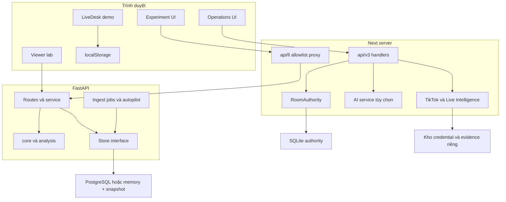
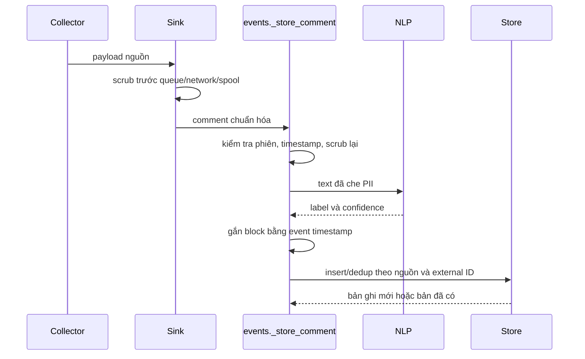
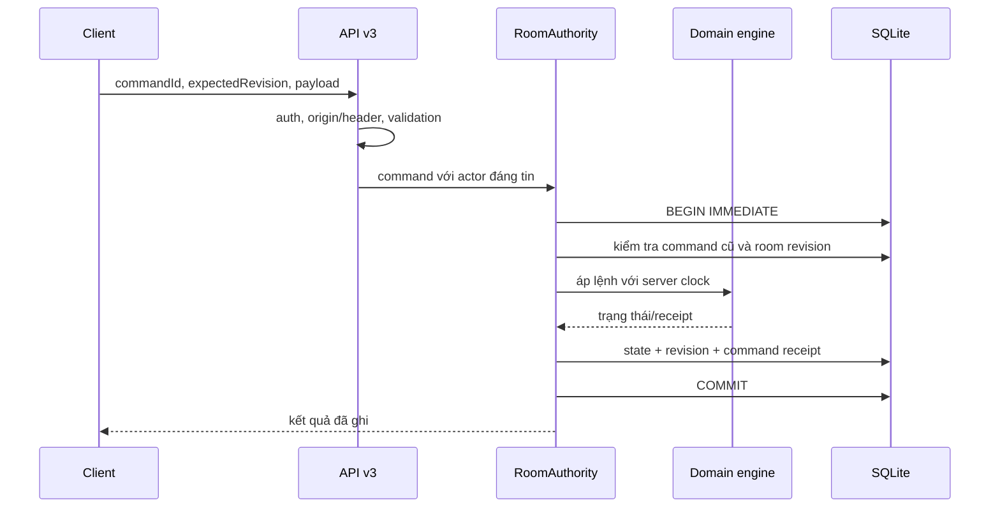

# LiveLift — Giải phẫu kỹ thuật và căn cứ để phản biện

> **Bản 2 — dành cho việc đọc sâu, trao đổi với người có chuyên môn và bảo vệ thiết kế.**
>
> Snapshot: commit `fc7abc5`, branch `Lamng`, ngày 19/10/2026. Tài liệu được viết từ mã nguồn và các tài liệu trong checkout; không phải báo cáo chạy thử mới. Các nhận xét về nhà cung cấp phản ánh adapter/config trong repo, không xác nhận quyền của một tài khoản đang hoạt động.
>
> Nếu cần xây nền trước, đọc [Bản 1 — Hiểu dự án dễ hiểu](01-HIEU-DU-AN-DE-HIEU.md). Bản này cố ý giữ tên symbol, thuật ngữ và công thức để có thể đối chiếu trực tiếp với code.

## Mục lục

1. [Phạm vi và kiến trúc](#t01)
2. [Bản đồ module](#t02)
3. [Khởi tạo ứng dụng Python và kho dữ liệu](#t03)
4. [Hợp đồng dữ liệu và vòng đời phiên](#t04)
5. [Thiết kế ngẫu nhiên hóa vòng ngoài](#t05)
6. [Chính sách chọn sản phẩm và thực thi](#t06)
7. [Pipeline thu thập, PII và NLP](#t07)
8. [Định nghĩa click, exposure và cửa sổ đo](#t08)
9. [Ước lượng, kiểm định và điều kiện trả kết quả](#t09)
10. [Mô phỏng và cách đọc benchmark](#t10)
11. [Hợp đồng giữa Next và Python](#t11)
12. [Phòng xem lab](#t12)
13. [Domain engine điều hành V3](#t13)
14. [SQLite authority, tính nhất quán và xác thực](#t14)
15. [Tích hợp nền tảng và bằng chứng theo thời gian](#t15)
16. [Copilot và ranh giới quyền của AI](#t16)
17. [Triển khai và vận hành](#t17)
18. [Kiểm thử hiện có và phạm vi xác minh](#t18)
19. [Sai khác tài liệu–code, hạn chế và hướng phát triển](#t19)
20. [Cách bảo vệ thiết kế trước hội đồng](#t20)

<a id="t01"></a>
## 1. Phạm vi và kiến trúc

### 1.1. Những hệ thống đang cùng tồn tại

Repo không phải một ứng dụng đơn khối có một mô hình dữ liệu duy nhất. Có bốn bề mặt cần phân biệt:

| Bề mặt | Entry point | Logic chủ đạo | Authority dữ liệu |
|---|---|---|---|
| Frontend cũ | `web/src/app` | Điều khiển/hiển thị thử nghiệm Python | Python store |
| Frontend thử nghiệm mới | `next/src/app/phien`, `xem` | UI và hợp đồng API | Python store qua proxy Next |
| LiveDesk demo | `next/src/app/page.tsx`, `desk` | Trải nghiệm phòng live mô phỏng | Browser store trong `lib/livedesk` |
| Operations V3 | `next/src/app/live`, `/api/v3` | Kịch bản, thời gian, recovery, review | Local store trong một số chế độ; server SQLite cho REAL |

**Authority** ở đây là nơi có quyền quyết định trạng thái chính thức. React state là bản hiển thị; không mặc nhiên là dữ liệu đã được máy chủ chấp nhận.

### 1.2. Sơ đồ ranh giới



### 1.3. Nguyên tắc đọc bằng chứng

- Một tên route có chữ `real` không đủ chứng minh nguồn thương mại thật.
- Có adapter không đồng nghĩa đã được cấp quyền, có credential hợp lệ hoặc đã chạy end-to-end.
- Một schema chứa trường không đồng nghĩa mọi pipeline đều ghi trường đó.
- Có test không đồng nghĩa test vừa được chạy ở commit hiện tại.
- Roadmap mô tả ý định. Khi mâu thuẫn về hành vi đang triển khai, ưu tiên code rồi ghi nhận khoảng cách.

Nguồn kiến trúc tích hợp: [hop-nhat-next-api.md](../kien-truc/hop-nhat-next-api.md).

<a id="t02"></a>
## 2. Bản đồ module

### 2.1. Python: trách nhiệm và nơi bắt đầu đọc

| Nhóm/file | Trách nhiệm | Đọc cùng |
|---|---|---|
| [api/main.py](../../src/livelift/api/main.py) | App factory, lifespan, health, middleware/dependency, gắn router | config, store, auth, autopilot, ingest_jobs |
| [api/schemas.py](../../src/livelift/api/schemas.py) | Hợp đồng Pydantic; trạng thái, platform, action card, host/operator view | Client Zod trong Next |
| [api/service.py](../../src/livelift/api/service.py) | Tạo lịch, xác định khối hiện tại, dựng state | core/assigner, store |
| [api/store.py](../../src/livelift/api/store.py) | Memory/PostgreSQL, snapshot, thao tác dữ liệu và broadcaster | migrations, config |
| [api/auth.py](../../src/livelift/api/auth.py) | Quyền ghi, ngoại lệ demo/public, giới hạn tần suất, proxy identity | main, config |
| [api/routes/sessions.py](../../src/livelift/api/routes/sessions.py) | Sản phẩm, shortlink, vòng đời phiên và lịch | service, schemas |
| [api/routes/actions.py](../../src/livelift/api/routes/actions.py) | Kiểm tra và ghi hành động; exposure | cards, ung_vien, inner |
| [api/cards.py](../../src/livelift/api/cards.py) | Điểm/độ bất định của ứng viên | product exposure, inner |
| [api/ung_vien.py](../../src/livelift/api/ung_vien.py) | Lọc ứng viên chung cho UI và thực thi | Tồn kho, phạm vi phòng |
| [api/autopilot.py](../../src/livelift/api/autopilot.py) | Chu kỳ tự chạy chính sách ở khối đủ điều kiện | actions, exposure đã lưu |
| [api/routes/events.py](../../src/livelift/api/routes/events.py) | Nhận, scrub, phân loại, gắn khối và lưu comment/tick | PII, NLP, store |
| [api/routes/redirect.py](../../src/livelift/api/routes/redirect.py) | Ghi click và chuyển hướng | core/click_validity |
| [api/routes/orders.py](../../src/livelift/api/routes/orders.py) | Nhập và quản lý dữ liệu đơn hàng | schemas, store |
| [api/routes/ingest.py](../../src/livelift/api/routes/ingest.py) + [ingest_jobs.py](../../src/livelift/api/ingest_jobs.py) | Điều khiển collector nền và trạng thái khôi phục | ingest adapters |
| [api/routes/replays.py](../../src/livelift/api/routes/replays.py) | Luồng dữ liệu phát lại | youtube_replay; phân tích quan sát |
| [api/routes/reports.py](../../src/livelift/api/routes/reports.py) | Tổng quan, báo cáo phiên, tổng hợp thử nghiệm, khóa kết quả | features, estimators, robust, power |
| [api/routes/xem.py](../../src/livelift/api/routes/xem.py) | Lab viewer, consent, heartbeat, sự kiện và rút lui | migration 0010, XemRoom |
| [api/routes/demo.py](../../src/livelift/api/routes/demo.py) | Sinh phiên mẫu | is_demo, bộ lọc phân tích |
| [api/routes/ws.py](../../src/livelift/api/routes/ws.py) | Đẩy cập nhật qua WebSocket | Broadcaster, web/useLiveSocket |
| [core/assigner/outer.py](../../src/livelift/core/assigner/outer.py) | Lịch switchback và cơ chế redraw | service, randomization inference |
| [core/assigner/inner.py](../../src/livelift/core/assigner/inner.py) | Chọn hành động giữa ứng viên chồng khoảng | cards, actions |
| [core/features.py](../../src/livelift/core/features.py) | Sự kiện → ticks → block frame, exposure | estimators |
| [core/click_validity.py](../../src/livelift/core/click_validity.py) | Quy tắc click hợp lệ không nhìn treatment | redirect, recount |
| [core/quality.py](../../src/livelift/core/quality.py) | Chất lượng, cân bằng, compliance | assignment/exposure logs |
| [core/signals.py](../../src/livelift/core/signals.py), [moments.py](../../src/livelift/core/moments.py) | Tín hiệu và mốc đáng chú ý mô tả hoạt động | reports; không thay phép đo nhân quả |
| [analysis/estimators.py](../../src/livelift/analysis/estimators.py) | Ước lượng, RI, CI | outer, features, adjust |
| [analysis/adjust.py](../../src/livelift/analysis/adjust.py) | Điều chỉnh CUPED/linearization | Covariate và giả định |
| [analysis/robust.py](../../src/livelift/analysis/robust.py) | Phân tích độ nhạy, FE và denominator gate | reports |
| [analysis/power.py](../../src/livelift/analysis/power.py) | Power/MDE | Thiết kế và biến thiên dữ liệu |
| [analysis/narrate.py](../../src/livelift/analysis/narrate.py) | Mẫu câu tóm tắt có tham chiếu số liệu | Không gọi LLM |
| [analysis/carryover.py](../../src/livelift/analysis/carryover.py) | Chỗ dành sẵn cho phân tích carryover | Hiện chưa có triển khai ước lượng |
| [ingest/](../../src/livelift/ingest/) | Adapter, CLI runner, spool, lọc PII | API events |
| [nlp/](../../src/livelift/nlp/) | Nhãn, chuẩn hóa, huấn luyện, đánh giá, artifact | intent.py là runtime |
| [sim/](../../src/livelift/sim/) | Sinh dữ liệu, truth đối chứng, lưới stress và báo cáo | Không phải dữ liệu kinh doanh |
| [dbops/migrate.py](../../src/livelift/dbops/migrate.py), [migrations/](../../src/livelift/migrations/) | Thay đổi schema PostgreSQL | CLI livelift-migrate |
| [config.py](../../src/livelift/config.py), [console.py](../../src/livelift/console.py) | Cấu hình I/O và hỗ trợ CLI | pyproject entry points |

Các `__init__.py` chủ yếu tổ chức package; các CLI như `core/assigner/cli.py`, `core/quality_cli.py`, `sim/cli.py` là cửa chạy từ terminal cho nhóm chức năng tương ứng.

### 2.2. Next: các vùng không nên trộn

| Vùng | Trách nhiệm |
|---|---|
| `app/phien`, `app/xem` + `components/phien` | Giao diện của experiment/lab Python |
| `lib/livelift-api` | Client, schema, allowlist, chuyển dữ liệu thành view model |
| `app/api/ll/[...path]` | Proxy server sang FastAPI |
| `components/livedesk`, `lib/livedesk` | LiveDesk mô phỏng, local state, gợi ý |
| `contracts` | Mô hình và hợp đồng command/authority V3 |
| `lib/domain` | Quy tắc nghiệp vụ thuần: plan, engine, forecast, recovery, review, nextLive |
| `components/ops` | Màn hình chuẩn bị, vận hành và tổng kết V3 |
| `lib/store` | Store trình duyệt và giao tiếp với authority từ xa |
| `lib/server` | SQLite, command authority, auth, lifecycle, backup, HTTP |
| `lib/server/tiktok` | Kết nối tài khoản TikTok và credential |
| `lib/server/liveIntelligence` | Nguồn bằng chứng Shop/Creator, snapshot và persistence |
| `lib/server/ai` | Provider LLM, ngữ cảnh và kiểm tra đầu ra |
| `lib/platform` + `components/platform` | Mô phỏng giao diện/khả năng nền tảng |
| `scripts` và `acceptance` | Công cụ vận hành, fixture và kiểm tra tích hợp |

<a id="t03"></a>
## 3. Khởi tạo ứng dụng Python và kho dữ liệu

### 3.1. Lifecycle

`create_app()` dựng FastAPI. Lifespan thực hiện các việc chính:

1. Tạo store theo backend đã chọn.
2. Gắn/khôi phục snapshot nếu dùng memory và cấu hình cho phép.
3. Khởi động autopilot.
4. Làm nóng mô hình NLP ở nền để giảm độ trễ lần gọi đầu.
5. Dựng ingest manager và nối lại các job đủ điều kiện từ cấu hình đã lưu.
6. Khi shutdown: dừng các vòng nền, chụp/lưu dữ liệu cần thiết và đóng store.

Đây là lý do chỉ đọc một route không đủ hiểu ứng dụng: một phần công việc diễn ra ở vòng nền, không cần người dùng bấm nút liên tục.

### 3.2. Chọn backend

`build_store` đọc `STORE_BACKEND` từ environment, mặc định memory. Chỉ đặt `DATABASE_URL` không tự chuyển ứng dụng sang PostgreSQL. Cấu hình Pydantic đọc `.env` cho nhiều thiết lập khác; không nên giả định mọi biến đều đi qua cùng đường đọc.

Memory store có snapshot mặc định tại `data/snapshot/livelift-store.json`, chu kỳ mặc định 30 giây. File được thay thế theo cách hạn chế đọc trúng bản ghi dở. Đây không phải WAL cho từng sự kiện; sự cố có thể làm mất dữ liệu từ lần snapshot thành công cuối, và thời gian đó có thể vượt 30 giây nếu chụp lỗi.

PostgreSQL store dùng connection pool và timeout riêng cho kết nối, chờ pool, câu lệnh và health ping. Các route cần kho chuyển lỗi không sẵn sàng thành HTTP 503 có thông tin retry thay vì treo vô hạn.

### 3.3. Health có nhiều cấp độ

`GET /health` có thể trả HTTP 200 trong tình trạng degraded. Cần đọc các trường như `status`, `storage_ok`, `durable` và thông tin classifier. “Tiến trình còn trả lời” khác “đủ điều kiện thu một phiên quan trọng”.

Không suy luận rằng Redis đang phân phối tất cả sự kiện giữa worker. Broadcaster hiện tại dùng hàng đợi trong tiến trình. Autopilot cũng là vòng nền theo tiến trình; triển khai nhiều worker cần giải quyết quyền sở hữu job và phân phối sự kiện trước.

Nguồn: [main.py](../../src/livelift/api/main.py), [store.py](../../src/livelift/api/store.py), [config.py](../../src/livelift/config.py).

<a id="t04"></a>
## 4. Hợp đồng dữ liệu và vòng đời phiên

### 4.1. Thực thể của hệ thống thử nghiệm

| Thực thể/bảng | Nội dung chủ đạo | Ý nghĩa khi phân tích |
|---|---|---|
| `product` | ID, tên, category, cost, price, stock, margin | Danh mục và điều kiện hành động |
| `live_session` | Platform, mode, lifecycle, thời điểm, design, cờ nguồn | Đơn vị phiên và điều kiện chọn mẫu |
| `experiment_block` | Chỉ số khối, phase, assignment, thời gian, washout | Đơn vị treatment theo thời gian |
| `session_tick` | Bucket thời gian, viewers, rates, clicks, sản phẩm ghim | Tích phân exposure và mô tả hoạt động |
| `comment_event` | Nội dung đã scrub, nhãn, confidence, nguồn/ID ngoài | Ý định bình luận; không phải đơn hàng |
| `shortlink` | Code, sản phẩm, phiên, URL đích | Định danh đích click |
| `click_event` | Thời gian, sản phẩm, khối, fingerprint, valid/reason | Primary outcome sau quy tắc lọc |
| `order_event` | ID đơn, thời gian, sản phẩm, qty, gross, fees, margin | Outcome/phân tích phụ tùy nguồn |
| `intervention_log` | Hành động, nguồn, executed, propensity, candidates | Nhật ký quyết định |
| `assignment_event` | Toàn bộ lịch và design_hash | Ý định phân nhóm trước thực thi |
| `exposure_event` | Pin/unpin/biên khối theo sự kiện | Đối chiếu treatment thực hiện |
| `reaction_event` | Tương tác từ nguồn hỗ trợ | Tín hiệu phụ |
| `analysis_run` | Metadata và kết quả chạy phân tích theo schema | Không suy ra mọi endpoint tự ghi một analysis_run |
| Dữ liệu phòng xem trong migration 0010 | Mã phòng và sự kiện viewer | Consent, dedup, hoạt động và rút lui |

Schema ban đầu chưa chứa đầy đủ trường hiện tại; cần đọc các migration sau. Có **10 migration tiến `0001`–`0010`**, cùng các file rollback tương ứng.

### 4.2. Một số ràng buộc đáng chú ý

- Session create yêu cầu thời lượng 5–480 phút; mode là `auto` hoặc `suggest`.
- Python lifecycle: `planned`, `scheduled`, `live`, `ended`, `cancelled`.
- `dry_run` được quyết định lúc tạo và dùng để loại phiên diễn tập khỏi mẫu gộp.
- `is_demo` không phải trường tùy ý trong body `SessionCreate`; server quản lý việc gắn nhãn mẫu qua các luồng demo, kể cả ngoại lệ khách public nếu cấu hình cho phép.
- `Platform` của phiên và `EventPlatform` của sự kiện không giống nhau: event có `shopee`, trong khi literal platform phiên hiện không có giá trị đó. Không nên tạo payload chỉ từ tên adapter.
- Shortlink chỉ nhận URL bắt đầu bằng HTTP/HTTPS.
- Host state và operator state là model riêng; host không được trả lịch/assignment trong response model đó.
- Action card phân biệt `source`; schema không cho forecast card mang CI kiểu kết quả experiment. Điểm số xếp hạng nội bộ vẫn có độ bất định riêng.

### 4.3. Bất biến ứng dụng không đồng nghĩa bất biến database

`assignment_event` và `exposure_event` được ghi theo kiểu append-only ở tầng store API. Migration 0006 ghi rõ không tự thu hồi quyền UPDATE/DELETE của DB role. Người có quyền quản trị cơ sở dữ liệu vẫn nằm ngoài bảo đảm đó.

Ngược lại, command log V3 có trigger bất biến ở SQLite. Hai cơ chế phải được mô tả riêng, không gộp thành “toàn hệ thống có log bất biến tuyệt đối”.

Nguồn: [schemas.py](../../src/livelift/api/schemas.py), [migration 0001](../../src/livelift/migrations/0001_init.up.sql), [0006](../../src/livelift/migrations/0006_event_tables.up.sql), [0010](../../src/livelift/migrations/0010_phong_xem.up.sql).

<a id="t05"></a>
## 5. Thiết kế ngẫu nhiên hóa vòng ngoài

### 5.1. Unit và estimand

Can thiệp ghim là can thiệp chung theo phòng. Unit được gán treatment là **khối thời gian trong phiên**. Mục tiêu chính của lõi thử nghiệm là chênh lệch outcome theo assignment, theo tinh thần intention-to-treat (ITT).

Không chuyển một khối từ ON sang OFF sau khi biết hệ thống không thực hiện, vì việc đó làm mất ý nghĩa ngẫu nhiên hóa. Compliance được báo cáo riêng.

### 5.2. `DesignParams` và lịch thực tế

Mặc định trong `outer.py`:

| Tham số | Giá trị | Tác dụng |
|---|---:|---|
| `block_min` | 5 | Độ dài danh nghĩa |
| `washout_min` | 0 | Khoảng washout thiết kế |
| `endpoint_double` | true | Kéo dài khối đầu/cuối |
| `jitter_s` | 30 | Dao động ranh giới |
| `p` | 0,5 | Xác suất Bernoulli ban đầu |
| `min_per_arm_per_phase` | 2 | Cân bằng tối thiểu theo phase khi khả thi |
| `min_transition_pairs` | 3 | Ràng buộc cặp liền nhau cùng arm khi khả thi |
| `max_redraws` | 10.000 | Giới hạn thử lại |

Với lịch 90 phút mặc định, có 16 khối đo: đầu/cuối dài xấp xỉ 10 phút, phần giữa xấp xỉ 5 phút với jitter. Phases là early/mid/late.

Cơ chế không phải hoán vị một danh sách có đúng 50% ON. Nó rút Bernoulli rồi chấp nhận lịch thỏa ràng buộc. Cân bằng per phase và cấu trúc cặp ON–ON/OFF–OFF tạo ra phân phối gán có điều kiện.

Khi lịch ngắn không đạt được ràng buộc gốc, code dùng mức thực hiện được và trả các trường `realized_*` cùng cảnh báo. Nếu không thể sinh lịch hợp lệ trong giới hạn, route có thể trả lỗi thay vì lặp vô tận.

### 5.3. Schedule commitment

`schedule_session` thực hiện chuỗi:

```text
DesignParams + seed
→ generate_schedule
→ lưu blocks
→ tính design_hash
→ append assignment events của toàn bộ lịch
→ lưu design, seed, số redraw và ràng buộc thực tế
→ status = scheduled
```

Có thể tạo lại lịch trước lúc live. Lịch sử assignment cũ không bị gộp tùy tiện; `design_hash` phân biệt từng lần tạo. Khi derive compliance phải chọn một design_hash, nếu không sẽ đếm lẫn lịch cũ.

Hash giúp kiểm tra tính nhất quán và tái lập. Không có bằng chứng trong cơ chế này rằng commitment đã được neo độc lập ngoài database trước buổi phát.

### 5.4. Dùng cùng cơ chế trong suy luận

Randomization inference gọi lại cơ chế draw theo các phase/ràng buộc của thiết kế. Tạo lịch theo một cơ chế rồi phân tích bằng một cơ chế tráo nhãn khác sẽ cho p-value không phản ánh thí nghiệm đã làm.

Nguồn: [outer.py](../../src/livelift/core/assigner/outer.py), [service.py](../../src/livelift/api/service.py), [estimators.py](../../src/livelift/analysis/estimators.py).

<a id="t06"></a>
## 6. Chính sách chọn sản phẩm và thực thi

### 6.1. Gamma–Poisson trong `build_candidates`

Với sản phẩm `j`, gọi:

```text
Cj = số click dùng để xếp hạng sản phẩm
Ej = viewer-seconds khi sản phẩm được ghim / 1.000
```

Code đặt một prior dựa trên pooled rate, với pseudo-exposure bằng 5. Dạng cập nhật:

```text
alpha_j = alpha_0 + Cj
beta_j  = 5 + Ej
mean_j  = alpha_j / beta_j
sd_j    = sqrt(alpha_j) / beta_j
```

Khoảng dùng để chọn ứng viên được dựng từ mean ± hệ số nhân sd, chặn ở 0. Đây là khoảng xấp xỉ cho điểm dự báo, không phải Fisher CI của hiệu ứng thử nghiệm.

Ở cold start, các ứng viên có prior giống nhau nên có thể cùng nằm trong tập cần khám phá. Code không cần mô hình deep learning để thực hiện chính sách này.

### 6.2. Lọc và chọn

`ung_vien.py` dùng chung logic cho hiển thị và thực thi, tránh UI đề xuất một tập nhưng backend chấp nhận tập khác. Có kiểm tra phạm vi sản phẩm phòng lab và ngưỡng tồn kho liên quan tốc độ bán. Dạng ngưỡng chính:

```text
max(3, ceil(2 × tốc độ bán theo phút × số phút của khối))
```

`choose_action` sắp theo mean, tie-break theo product ID, lấy những ứng viên có khoảng chồng với ứng viên đứng đầu. Nếu chỉ một ứng viên thì propensity 1; nếu k ứng viên thì chọn đều với propensity `1/k`.

Số click xếp hạng và primary valid-click outcome không đồng nhất hoàn toàn trong triển khai. Không diễn giải ranking score thành causal lift của từng sản phẩm.

### 6.3. Thực thi và autopilot

`execute_action` kiểm tra trạng thái live, không phải phiên observational, khối ON và không washout. Nếu card do client yêu cầu không thuộc tập được phép, code từ chối thay vì âm thầm chọn tùy ý.

Sau khi chọn, hệ thống ghi intervention, xác suất chọn, tập ứng viên đã xét, exposure pin và phát cập nhật. `executed=true` trong luồng này mô tả thực thi nội bộ; hàm không gửi lệnh ghim đến nền tảng bên ngoài.

Autopilot gọi cùng logic, nhìn exposure đã lưu để tránh lặp hành động cho khối đã có thực thi. Chu kỳ mặc định khoảng một giây. Việc này không cung cấp distributed leader election cho nhiều process.

### 6.4. Compliance

`derive_compliance` đối chiếu assignment với exposure. Trong cách tính hiện tại, có pin nguồn `model` trong khối ON là tiêu chí hiện diện treatment; nó không đo đầy đủ tỷ lệ thời gian người xem thực sự thấy pin. Pin nguồn `human` không được tự tính là hệ thống đã tuân thủ.

Có báo cáo nhiễm treatment ở OFF. ITT vẫn theo assignment ban đầu. Tên trường hoặc mô tả lịch sử về “share of time” không thay thế cách tính thực tế đang chạy.

Nguồn: [cards](../../src/livelift/api/cards.py), [ung_vien](../../src/livelift/api/ung_vien.py), [inner](../../src/livelift/core/assigner/inner.py), [actions](../../src/livelift/api/routes/actions.py), [quality](../../src/livelift/core/quality.py).

<a id="t07"></a>
## 7. Pipeline thu thập, PII và NLP

### 7.1. Hai đường ingest

| Đường | Cơ chế | Giới hạn cần nhớ |
|---|---|---|
| CLI collector → `ApiSink` → HTTP API | Retry/backoff, sau lỗi chuyển sang spool JSONL đã scrub, có replay | 400/422 được xem là dữ liệu sai và không replay như lỗi tạm thời |
| `IngestManager` trong API → `StoreSink` | Async tasks, queue hữu hạn, gọi hàm lưu qua thread | Có dropped counter khi quá tải; queue không phải durable disk log |

IngestManager lưu thông tin job trong `data/ingest-jobs.json` để có thể nối lại nguồn khi API restart và phiên còn hợp lệ. Nối lại collector không bảo đảm nền tảng trả lại toàn bộ khoảng dữ liệu đã bỏ lỡ.

### 7.2. Đường đi của comment



Gắn khối theo event time giúp comment đến trễ vẫn thuộc thời điểm phát sinh được báo cáo. Độ tin cậy timestamp nguồn vẫn là giả định dữ liệu; không phải mọi nền tảng có cùng độ trễ.

Không lưu tác giả thô trong đường comment chính. Bản ghi chứa `text_scrubbed`, loại PII đã phát hiện, intent, confidence; `sentiment` trong luồng này không phải một mô hình cảm xúc đang được tính đầy đủ.

### 7.3. PII filter

Có chuẩn hóa Unicode NFKC, phát hiện nhiều loại span và quy tắc ưu tiên khi các mẫu chồng nhau. Các loại gồm email, tài khoản mạng xã hội, ngân hàng, mã đơn, số điện thoại, địa chỉ và tên theo mẫu hỗ trợ.

Đặt scrub trước spool/network là chi tiết kiến trúc quan trọng: nếu chỉ che ở màn hình cuối thì log hoặc file retry vẫn có thể giữ bản thô. Tuy vậy, regex/rule không bảo đảm nhận diện mọi PII trong ngôn ngữ tự nhiên.

### 7.4. Mô hình intent mặc định

Pipeline trong `train_intent.py`:

```text
FeatureUnion
  ├─ TF-IDF char_wb, n-gram 2–5
  └─ TF-IDF word, n-gram 1–2
→ LogisticRegression(C=4, class_weight=balanced,
                     max_iter=2000, random_state=2026)
```

TF-IDF dùng `min_df=2` và sublinear term frequency. v1 có sáu nhãn; v2 mở lên 11 nhãn và thêm đặc trưng phong cách. Runtime mặc định chọn v1; `LIVELIFT_INTENT_MODEL=v2` là opt-in.

`predict_proba` lấy lớp có xác suất cao nhất. Dưới 0,45 thì nhãn trả về `khac`, nhưng vẫn giữ confidence. Lỗi artifact, phiên bản hoặc suy luận có thể kích hoạt keyword fallback với confidence không giống mô hình. `/health` giúp nhận biết chế độ thực tế.

Extra ML khóa scikit-learn `1.9.0` vì artifact joblib phụ thuộc tương thích thư viện. Có dependency LightGBM/statsmodels không có nghĩa classifier hiện tại dùng LightGBM.

### 7.5. Dữ liệu huấn luyện và giới hạn đánh giá

- v1 metadata: 320 mẫu soạn bằng AI, sáu lớp.
- v2 metadata: 2.513 mẫu, gồm 393 gold theo cách gọi của bộ dữ liệu, 320 mẫu soạn và 1.800 mẫu LLM; nhãn tham chiếu có nguồn AI, không mặc định là người gán độc lập.
- Có đánh giá leave-one-session-out trên 393 mẫu thuộc ba phiên. Artifact phát hành có thể được huấn luyện lại trên toàn bộ tập sau đánh giá; không nhầm artifact cuối với mô hình của từng fold.
- Điểm 11 lớp v1 so với v2 bị ảnh hưởng bởi khác không gian nhãn. So sánh sáu lớp chung được tài liệu ghi khoảng 0,370 → 0,572; không thay bằng tuyên bố “độ chính xác thực tế đã đạt X%”.

Nguồn: [runner](../../src/livelift/ingest/runner.py), [ingest_jobs](../../src/livelift/api/ingest_jobs.py), [events](../../src/livelift/api/routes/events.py), [PII](../../src/livelift/ingest/pii/filter.py), [train](../../src/livelift/nlp/train_intent.py), [intent](../../src/livelift/nlp/intent.py), [v1 metadata](../../src/livelift/nlp/model/intent_clf.meta.json), [v2 metadata](../../src/livelift/nlp/model/intent_clf_v2.meta.json), [báo cáo NLP](../competition/sang-tao-tre-2026/03-NLP-NANG-CAP.md).

<a id="t08"></a>
## 8. Định nghĩa click, exposure và cửa sổ đo

### 8.1. Redirect và fingerprint

`/r/{code}` tìm shortlink, tạo click event rồi trả 302. Lookup link xảy ra trước phần cố gắng ghi nhận không cản redirect. Vì vậy chỉ có bảo đảm tương đối: lỗi ghi sau khi đã resolve URL không nên làm mất đường đi của người xem.

Fingerprint redirect dùng hash của salt trong process, phiên, địa chỉ client và user agent; giá trị lưu được rút gọn còn 32 ký tự. Không lưu IP/UA thô trong click record này. Salt trong process không đồng nghĩa pseudonym bền vững qua mọi lần restart.

IP sau reverse proxy chỉ đáng tin khi hop trực tiếp thuộc `trusted_proxy_cidrs`. Nếu cấu hình sai, mọi người có thể bị gom vào IP proxy hoặc caller có thể giả header; cả hai ảnh hưởng dedup/rate limit.

### 8.2. Valid-click rules

| Reason | Điều kiện chính |
|---|---|
| `givt_ua` | User agent khớp tập mẫu bot/crawler/tool |
| `prefetch` | Header cho biết prefetch/prerender/preview |
| `non_get` | Phương thức không phải GET |
| `refractory` | Cùng fingerprint/link có click được tính quá gần; mặc định 10 giây |
| `volume_cap` | Vượt 5 click được tính cho fingerprint/link/block |

Giữ sự kiện cùng valid flag/reason. Assignment-blindness là bất biến: quy tắc không nhận ON/OFF hay propensity để tránh lựa chọn outcome theo treatment. Recount chỉ tái tính được phần có dữ liệu đã lưu; UA/header thô không được lưu để suy lại mọi quyết định ban đầu.

Đây là bộ lọc nhẹ theo quy tắc, không phải chứng nhận rằng mọi bot đều bị loại và mọi người thật đều được nhận đúng.

### 8.3. `block_frame`

Gọi `V(t)` là viewers tại thời điểm `t`, được biểu diễn theo các đoạn của tick. Với cửa sổ đo `W_b` của khối b:

```text
E_b = tích phân V(t) trên W_b                  [viewer-seconds]
C_b = số valid clicks có timestamp thuộc W_b  [clicks]
Y_b = 1.000 × C_b / E_b                       [clicks / 1.000 viewer-seconds]
```

Phải dùng cùng `W_b` cho tử và mẫu. Nếu bỏ burn-in khỏi click nhưng vẫn giữ toàn bộ exposure, tỷ lệ sẽ bị lệch.

Luồng hiện có burn-in mặc định 60 giây và ngưỡng exposure tối thiểu 60 viewer-seconds. Cửa sổ còn bị giới hạn bởi thời gian phiên thực sự đã chạy; khối chưa phát sóng không được trở thành một dòng outcome 0.

Khi phân tích, giữ toàn bộ layout thiết kế để sinh assignment, rồi áp cùng mask đo được. Không tự rút ngắn thí nghiệm thành vài khối còn dữ liệu và bốc thăm lại với ràng buộc khác. Tuy nhiên, nếu khả năng đo được phụ thuộc treatment, việc có mask cố định khi tính toán chưa đủ tự chứng minh mất dữ liệu là vô hại.

### 8.4. Dashboard không phải estimator

Tổng valid clicks chia tổng exposure toàn phiên trên UI có thể khác trung bình các tỷ lệ từng khối. UI còn có thể tính cả thời gian burn-in trong phần tổng quan. Hai con số có nhiệm vụ khác nhau; không gọi mọi tỷ lệ trên màn hình là estimate từ thí nghiệm.

Nguồn: [redirect](../../src/livelift/api/routes/redirect.py), [click_validity](../../src/livelift/core/click_validity.py), [features](../../src/livelift/core/features.py), [desk.ts](../../next/src/lib/livelift-api/desk.ts).

<a id="t09"></a>
## 9. Ước lượng, kiểm định và điều kiện trả kết quả

### 9.1. Ước lượng chính

Với `Z_b ∈ {0,1}` là assignment và outcome `Y_b` ở trên, cấu hình mặc định của `analyze_outer` dùng tỷ lệ chưa điều chỉnh:

```text
tau_hat = mean(Y_b | Z_b=1) − mean(Y_b | Z_b=0)
```

Đây là difference in means giữa outcome từng khối, không phải mặc định lấy tổng click ON/tổng exposure ON trừ tổng click OFF/tổng exposure OFF. Trọng số và estimand cần được trình bày đúng với hàm sử dụng.

Có Horvitz–Thompson và các nhánh điều chỉnh/phân tích bổ sung. Sự tồn tại của hàm không có nghĩa mọi báo cáo mặc định đều bật chúng.

### 9.2. Randomization inference

Statistic được studentize: chênh lệch chia cho ước lượng sai số tương ứng. Với B lần draw hợp lệ:

```text
p = (1 + số draw có |T_draw| >= |T_observed| theo tolerance số học)
    / (1 + B)
```

Điều chỉnh cộng 1 tránh p=0 do số lần mô phỏng hữu hạn. Các trường hợp bằng nhau phải được tính đúng; repo có lịch sử sửa xử lý numerical ties trong benchmark tháng 10.

Draw dùng cơ chế gán của từng phiên, không hoán vị xuyên phiên tùy tiện. Với thiết kế ngắn có ít lịch hợp lệ, độ phân giải kiểm định bị giới hạn; tăng số draw không tạo thêm những lịch không tồn tại trong thiết kế.

### 9.3. Khoảng tin cậy Fisher

Với một giá trị tác động giả định `tau`, dựng outcome đã trừ `tau × Z`, kiểm định giả thuyết đó rồi tìm vùng các tau không bị bác bỏ. Code mở rộng bracket và tìm biên bằng bisection.

Đây là đảo kiểm định dưới giả thuyết hiệu ứng cộng hằng số. Không tự suy ra coverage chính xác cho mọi dị biệt hiệu ứng hoặc mọi dạng carryover. Nếu không tìm được biên hữu hạn, báo cáo cần nói thiếu khả năng ước lượng thay vì cắt thành một con số đẹp.

### 9.4. Số lần draw khác nhau theo entry point

| Nơi | Giá trị cần phân biệt |
|---|---|
| Default của `analyze_outer` | 2.000 |
| Các lời gọi báo cáo API chính đang đọc | 1.000, seed 2026 |
| PREREGISTRATION | Mô tả các mức 2.000/10.000 theo giai đoạn |
| Lưới benchmark phòng live tháng 10 | Có cấu hình 200 draw cho từng phép tính trong lưới |

Khi tái lập một số liệu phải ghi entry point và tham số, không chỉ nói “dự án dùng 10.000 phép hoán vị”.

### 9.5. Điều kiện báo cáo và mẫu phân tích

`_bao_cao_ket_qua`/`/bao-cao` kiểm tra trạng thái phiên, thời điểm freeze nếu áp dụng, tối thiểu 4 khối đo, ít nhất 2 khối mỗi arm theo estimator, nguồn click và kết quả có thể ước lượng. Phiên observational trả nội dung mô tả thay cho suy luận thử nghiệm. Demo có ngoại lệ đối với các khóa phục vụ trình diễn.

Tổng hợp `/experiment/summary` yêu cầu tối thiểu 2 phiên đủ điều kiện và 8 khối đo. `_in_analysis_sample` loại phiên chưa ended, `analysis_only`, `dry_run` và không khớp chế độ demo. **Hàm này không loại riêng `platform=lab`**. Vì thế `env=real` có nghĩa bộ lọc non-demo theo code, không tự xác nhận một mẫu khách hàng thương mại.

Endpoint cũ `/sessions/{id}/report` có đường tính difference in means khi đủ khối mà không có toàn bộ khóa freeze/live của `/bao-cao`. Phát biểu “toàn hệ thống chặn peeking” sẽ vượt quá triển khai.

### 9.6. Các lớp bổ sung

- **CUPED/linearization:** có thể giảm phương sai, nhưng cần covariate và mô hình phù hợp. Biến đo sau treatment hoặc outcome trước khối chịu carryover không tự trở thành covariate vô hại.
- **OLS FE/Lin, cluster robust:** phân tích độ nhạy với hiệu ứng cố định và sai số theo cụm; không thay thế thiết kế gán.
- **ICS/denominator gate:** xem mẫu số exposure có thay đổi theo treatment không. Tỷ lệ và tổng tác động có thể khác nhau nếu treatment làm thay đổi lượng xem.
- **Power/MDE:** đánh giá khả năng phát hiện một mức tác động ở thiết kế/biến thiên giả định; không phải dự báo lift sẽ đạt được.
- **Orders/GMV:** outcome hiếm cần nhiều dữ liệu hơn, thêm giả định nguồn và độ trễ; không suy từ uplift click sang uplift doanh thu.
- **Narrative:** `narrate.py` sinh mẫu câu xác định từ input có tham chiếu, không giao phép kết luận thống kê cho LLM.

Nguồn: [estimators](../../src/livelift/analysis/estimators.py), [adjust](../../src/livelift/analysis/adjust.py), [robust](../../src/livelift/analysis/robust.py), [power](../../src/livelift/analysis/power.py), [reports](../../src/livelift/api/routes/reports.py), [PREREGISTRATION](../../PREREGISTRATION.md).

<a id="t10"></a>
## 10. Mô phỏng và cách đọc benchmark

### 10.1. Ba nghĩa khác nhau của “simulation”

| Hình thức | Mục tiêu | Có thể chứng minh gì? |
|---|---|---|
| Python statistical simulator | Sinh thế giới có truth biết trước | Bias, false positives, coverage, power trong thế giới giả định |
| Next LiveDesk/Shopee simulator | Thử UI và hành vi điều hành | Luồng tương tác và logic mô hình hóa |
| Lab viewer | Người tham gia thao tác trong phòng do nhóm tổ chức | Pipeline và hành vi trong bối cảnh thử có kiểm soát |

Không dùng số liệu loại này để ngầm xác nhận loại khác.

### 10.2. Simulator cơ sở

`simulate_session` mô hình hóa người đến, ở lại, hoạt động và phản ứng theo thời gian. Các luồng ngẫu nhiên của thế giới và click được tách để việc thay policy không tùy tiện thay mọi nguồn noise.

`true_effect` chạy all-ON và all-OFF với common random numbers: giữ cùng thế giới ngẫu nhiên để chênh lệch phản ánh cơ chế treatment được đưa vào mô hình. Đây là truth của simulator, không phải truth quan sát được của khách hàng ngoài thực tế.

### 10.3. `LiveRoomSim`

Lớp mở rộng có thể bật bounce, độ trễ đơn theo phân phối Gamma, phản hồi lưu lượng qua tham số beta và cấu trúc sản phẩm. Cấu hình trung tính được thiết kế giữ hành vi nền. Một số giới hạn:

- Cơ chế traffic feedback là giả định mô phỏng, không phải mô hình đã học thuật toán TikTok.
- Đơn được sinh hậu xử lý từ click và có thể bị loại nếu thời điểm vượt cuối phiên.
- Sản phẩm ON tập trung vào mục tiêu, OFF có cơ chế xoay; không có đầy đủ mô hình cannibalization giữa sản phẩm.
- Truth tỷ lệ và `gte_total_per_min` trả lời hai câu khác nhau khi lượng xem bị treatment tác động.

### 10.4. Các số lịch sử có thể trích, kèm phạm vi

Theo [báo cáo phòng live 15/10](../benchmarks/liveroom-kiem-dinh.md): lưới 40 cấu hình × 200 lần lặp, 3 phiên × 120 phút, có các burn-in 0/60/120/180 giây trên cùng mẫu sinh.

| Kết quả được ghi | Phạm vi diễn giải |
|---|---|
| False positive trung bình khoảng 4,3%, các ô khoảng 0,5–7,5% | Mức báo động giả phụ thuộc cấu hình mô phỏng |
| Effect +30% sạch: power khoảng 95% với khối 5 phút, 63% với khối 10 phút | Chỉ trong thiết kế và số phiên của benchmark |
| Coverage khoảng 95,5% ở tình huống sạch được báo cáo | Không đại diện mọi ô stress |
| Carryover có half-life 5 phút: bias xấu, khoảng −46% đến −35% khi tăng burn-in từ 0 lên 180 giây | Half-life là thời gian dư âm giảm một nửa; burn-in không giải quyết hoàn toàn tác động kéo dài |
| Coverage trong ca carryover cải thiện khoảng 53% lên 84,5% | Vẫn có thể thấp hơn mục tiêu danh nghĩa |
| Một ca beta=0,5 có tổng tăng khoảng 52% trong khi rate effect 30% | Tổng và tỷ lệ khác nhau khi exposure bị tác động |

README còn lưu benchmark tháng 9 với quy mô/tham số khác. Không ghép hai benchmark thành một tập kết quả, không gọi số test lịch sử là kết quả vừa chạy.

Nguồn code: [simulator.py](../../src/livelift/sim/simulator.py), [liveroom.py](../../src/livelift/sim/liveroom.py), [liveroom_grid.py](../../src/livelift/sim/liveroom_grid.py).

<a id="t11"></a>
## 11. Hợp đồng giữa Next và Python

### 11.1. API bridge

`/api/ll/[...path]/route.ts` chuyển GET/POST được cho phép sang `LIVELIFT_API_BASE`, có thể gắn `LIVELIFT_API_TOKEN` phía server. Allowlist ngăn biến proxy thành đường chuyển tiếp URL tùy ý.

Ví dụ các nhóm được bridge hỗ trợ:

| Nhóm | Đường dẫn Python tiêu biểu |
|---|---|
| Sức khỏe/danh mục | `/health`, `/products` |
| Phiên | `/sessions`, `/sessions/{id}` |
| Dữ liệu hiển thị | `/sessions/{id}/state`, `schedule`, `ticks`, `comments`, `orders`, `signals` |
| Báo cáo | `/sessions/{id}/report`, `/sessions/{id}/bao-cao` |
| Điều khiển | `/sessions/{id}/schedule`, `start`, `end`, `actions/execute`, `phong-xem` |
| Demo | Các endpoint seed trong allowlist |

Chỉ những tổ hợp method/path được allowlist chấp nhận mới được đi qua; bảng trên không thay thế danh sách đầy đủ trong code. Query cũng được lọc. Đường có traversal, encoded separator hoặc backslash bị từ chối. Timeout bridge hiện 15 giây; lỗi mạng được chuyển thành 502.

**Ranh giới quyền:** bridge này không gọi lớp `authorized()` của V3. Nó giữ bí mật token khỏi browser nhưng bản thân caller của bridge chưa được xác thực bằng cookie V3. Cần xét đường public/deployment trước khi coi đó là bàn điều hành đã được bảo vệ.

### 11.2. Contract client

`client.ts` dùng Zod để parse response. Điều này bắt được lỗi hợp đồng như thiếu trường hoặc sai dạng dữ liệu trước khi dữ liệu lan vào UI.

Các màn hình thử nghiệm dùng polling khoảng 2 giây, có nhóm GET song song cho session/schedule/state/ticks/comments/orders và report ở mỗi vòng thứ năm, khoảng 10 giây. Dữ liệu phụ có thể giữ giá trị cũ khi request thất bại; lỗi session/schedule/state có tác động mạnh hơn.

Vì vậy một `updatedAt` chung không bảo đảm mọi ô hiển thị đều có cùng độ mới. Đây là điểm nên cải thiện nếu cần hiển thị freshness theo từng nguồn.

### 11.3. View model và verdict

`desk.ts` chuyển dữ liệu API thành thông tin vận hành:

- Funnel/totals: số liệu mô tả, không tự áp estimator và burn-in.
- `roomPulse`: so hai cửa sổ gần nhất với mốc tham chiếu từ các cửa sổ trước; dùng nhóm 10 tick khoảng 5 phút, cần lịch sử đủ dài. Đây là tín hiệu mô tả, không sửa lịch ngẫu nhiên hóa.
- Verdict dựa trên CI: nằm hẳn trên 0, hẳn dưới 0, cắt 0, bị khóa hoặc observational.
- `sourceLabel`: ánh xạ platform/cờ nguồn thành nhãn. Trong mapping hiện tại replay có thể được đưa vào nhóm “MÔ PHỎNG”; fallback “THẬT” không tự kiểm chứng nguồn chính thức.

### 11.4. UI cũ khác gì?

`web/` dùng REST polling và WebSocket `/ws/{id}` để cập nhật bàn điều hành. Các nhánh mock/demo phải đọc theo cấu hình của UI đó. Không suy từ việc WebSocket tồn tại trong Python rằng trang `/phien` mới cũng sử dụng cùng cách cập nhật.

Nguồn: [allowlist](../../next/src/lib/livelift-api/allowlist.ts), [proxy route](../../next/src/app/api/ll/[...path]/route.ts), [client](../../next/src/lib/livelift-api/client.ts), [types](../../next/src/lib/livelift-api/types.ts), [desk](../../next/src/lib/livelift-api/desk.ts), [useDesk cũ](../../web/src/lib/useDesk.ts).

<a id="t12"></a>
## 12. Phòng xem lab

### 12.1. Hợp đồng public có giới hạn

Viewer vào `/xem/[code]`. Hai nhóm API chính là đọc `/xem-api/{code}/trang-thai` và gửi `/xem-api/{code}/su-kien`.

Các loại sự kiện gồm `dong_y`, `nhip`, `xem_san_pham`, `bam`, `them_gio`, `mua`, `binh_luan`, `rut_lui`. Mã viewer được băm theo dạng có namespace lab và session; ID event dùng cho dedup.

Chưa consent thì nhận lỗi 403 ở đường cần consent; viewer đã rút lui bị chặn với 410. Có rate limit theo địa chỉ và viewer để phục vụ nhiều người sau cùng Wi-Fi nhưng vẫn hạn chế một nguồn spam.

### 12.2. Nghĩa của sự kiện

- Comment đi qua cùng đường scrub/classify.
- Click có quan hệ với dữ liệu đo của phiên.
- `mua` tạo order giả lập theo giá sản phẩm và số lượng của luồng thử; không có payment settlement.
- Viewers theo bucket 30 giây được tính từ viewer hash có sự kiện không phải withdrawal trong bucket, không chỉ mỗi heartbeat. Đây là phép đo hoạt động của phòng thử.
- Pin của viewer có logic theo khối hiện tại; không đồng nhất với pin tồn tại từ khối trước trên operator state.

### 12.3. Withdrawal

Rút lui xóa click/comment/order/lab event liên quan và recount ticks. Một tombstone chứa dấu nhận diện đã băm được giữ để ngăn gửi tiếp. Giải thích quyền rút lui phải phản ánh phần giữ lại có chủ đích này.

### 12.4. Public tunnel

`docker/Caddyfile.tunnel` chỉ chuyển các nhóm `/xem-api/*`, `/r/*`, `/xem/*`, `/_next/*`; các đường khác trả 404. Cấu hình dùng cổng 8088 và upstream `host.docker.internal`, cần ánh xạ phù hợp nếu môi trường Linux chưa cung cấp tên này.

Phòng lab giúp kiểm tra pipeline có người thao tác, nhưng không chứng minh external validity đối với khách hàng tự nhiên. Bộ lọc mẫu gộp hiện cần chú ý lab như mục 9 đã nêu.

Nguồn: [xem.py](../../src/livelift/api/routes/xem.py), [XemRoom](../../next/src/components/phien/XemRoom.tsx), [Caddy tunnel](../../docker/Caddyfile.tunnel), [mo_phong_xem.py](../../scripts/mo_phong_xem.py).

<a id="t13"></a>
## 13. Domain engine điều hành V3

### 13.1. Mô hình nghiệp vụ

| Khái niệm | Vai trò |
|---|---|
| `Session` | Một buổi vận hành với plan, run và events |
| `Segment` | Một đoạn kịch bản có nội dung/thời lượng/ràng buộc |
| `Cue` | Việc cần nhắc hoặc thao tác được lên kế hoạch |
| `PlanVersion` | Phiên bản kế hoạch; baseline được giữ khi bắt đầu |
| `SessionEvent` | Việc xảy ra, thời gian xảy ra và thời gian được ghi nhận |
| `Command` | Ý định thay đổi trạng thái, có khóa chống gửi trùng |
| `Receipt` | Kết quả chấp nhận/từ chối lệnh, hỗ trợ hòa giải trạng thái |
| `Recovery option` | Phương án xử lý đã được chạy thử qua quy tắc |

Session V3 dùng `planned → active → ended`, khác `planned → scheduled → live → ended` của Python. Segment có trạng thái pending/active/completed/skipped.

### 13.2. `applyCommand` là reducer thuần

Đầu vào gồm trạng thái hiện tại, command và thời gian được truyền vào. Hàm kiểm tra payload, state, ràng buộc rồi tạo trạng thái/receipt tương ứng. Nó không trực tiếp gọi TikTok hoặc ghi SQLite.

Một số command quan trọng:

- `start_live`, `start_segment`, `end_segment`, `advance_segment`, `end_live`.
- `shorten_segment`, `extend_segment`, `commit_end_by`.
- `set_remaining_estimate`, `mark_remaining_unknown`.
- `skip_segment`, `reorder_segment`, `reanchor_segment`.
- `report_cue`, `report_manual_action`, `add_note` và các đường correction.

Kiểm tra số hữu hạn/range diễn ra trước tính toán. Từ chối có mã như `stale_revision`, `invalid_state`, `plan_invalid`, `constraint_violation`; không phải mọi input xấu đều làm crash app.

### 13.3. Những bất biến cần bảo vệ

1. Baseline plan không được thay sau khi live đã bắt đầu; thay đổi tạo revision mới.
2. Một đoạn cần đủ điều kiện mới được start/end/skip; các ngoại lệ dưới thời lượng tối thiểu hoặc mất coverage cần được nhận biết rõ.
3. Coverage là điều người vận hành khai báo, không tự suy “chạy đủ phút = hoàn thành nội dung”.
4. Hard anchor chỉ đổi qua lệnh reanchor rõ ràng.
5. Kết thúc đóng runtime; ghi chú/correction là các bổ sung có dấu vết, không viết lại lịch sử tùy ý.
6. Chế độ SIM có clock riêng; command REAL không được tùy ý tin đồng hồ client ở authority máy chủ.

### 13.4. Forecast và recovery

Forecast duyệt kế hoạch theo thứ tự, xét thời gian đã chạy, estimate còn lại và anchor. Với anchor, thời điểm bắt đầu phải xét `max(cursor, anchor)`. Nếu độ dài còn lại không biết, hệ thống giữ tình trạng không chắc hoặc lower bound thay vì invent thời điểm kết thúc.

Recovery tạo lựa chọn như rút đoạn pending, bỏ đoạn optional, cam kết end-by hoặc điều chỉnh mốc có chủ ý. Mỗi option được preview bằng cùng `applyCommand`, nên nguyên tắc kiểm tra không tách thành một bản cho UI và một bản cho thực thi.

### 13.5. Review và next-live

Review so baseline với thực tế, lấy events/coverage và quyết định được ghi. `nextLive` tạo phiên mới từ các thay đổi được chọn, xóa runtime/event history không thuộc buổi mới.

`asKnownThen` dựng lại những gì đã được ghi nhận tới cutoff; dữ liệu biết sau không được đưa vào như thể người vận hành đã biết lúc quyết định. Đây là nguyên tắc temporal provenance, hữu ích khi đánh giá các gợi ý và quyết định.

Nguồn: [contracts](../../next/src/contracts/), [engine](../../next/src/lib/domain/engine.ts), [forecast](../../next/src/lib/domain/forecast.ts), [recovery](../../next/src/lib/domain/recovery.ts), [review](../../next/src/lib/domain/review.ts), [nextLive](../../next/src/lib/domain/nextLive.ts), [asKnownThen](../../next/src/lib/domain/asKnownThen.ts).

<a id="t14"></a>
## 14. SQLite authority, tính nhất quán và xác thực

### 14.1. Vì sao có RoomAuthority?

Một pure reducer chỉ nói “nếu áp lệnh này thì trạng thái sẽ là gì”. Nó chưa giải quyết hai người gửi lệnh cùng lúc, mất mạng sau commit, quyền của người gửi hay tính bền vững trên đĩa.

`RoomAuthority` là lớp quyết định và ghi trạng thái REAL phía máy chủ. SQLite dùng `node:sqlite`, WAL, `synchronous=FULL`, foreign keys và transaction `BEGIN IMMEDIATE` cho thao tác thay đổi.

### 14.2. Vòng đời một command



### 14.3. Idempotency và concurrency

- `commandId` dạng UUID là khóa nhận diện yêu cầu.
- Gửi lại cùng ID với cùng ý định chuẩn hóa và actor có thể nhận receipt cũ.
- Tái dùng ID cho ý định khác bị conflict, không được coi là retry hợp lệ.
- `expectedRevision` ở envelope authority là revision của room; không trộn với revision nội bộ session trong domain.
- Client dựa trên revision cũ nhận 409 thay vì last-write-wins.
- Có ràng buộc một session REAL active trong room.
- State, revision và receipt được commit cùng giao dịch.
- Command log có trigger ngăn update/delete/replace.

Nếu mạng mất sau khi server đã commit, trạng thái phía client là **chưa biết kết quả**, không phải chắc chắn thất bại. Client có thể truy vấn receipt theo command ID rồi reconcile, tránh phát một lệnh mới làm việc đó hai lần.

### 14.4. Xác thực production

Production có workspace ID, deployment generation và user/account server. Password được hash bằng scrypt với salt; cấu hình đọc thấy N=131072, r=8, p=1. Session login dùng token hash trong kho và cookie `__Host-livelift_session`, Secure, HttpOnly, SameSite=Strict; TTL cấu hình hiện 12 giờ.

Role `operator` và `viewer` quyết định quyền thao tác. Các write route kiểm tra origin/header phù hợp để giảm nguy cơ yêu cầu giả từ trang khác. Context workspace/generation ngăn một số việc sử dụng phiên cũ sau thay đổi vòng đời deployment.

Chế độ harness development có capability bearer riêng; production không tự fallback về cơ chế đó khi cookie lỗi.

### 14.5. Những gì không được suy ra từ lớp auth này

- `next/src/proxy.ts` chủ yếu đặt CSP/security headers; matcher còn loại API. Nó không phải cổng đăng nhập chung cho mọi route.
- `/api/ll` không tự áp `authorized()` V3.
- FastAPI có token ghi dùng chung, không phải đầy đủ tài khoản/tenant như V3.
- `role=host` phía Python chọn response shape, không xác thực danh tính người dẫn.

Nguồn: [authority](../../next/src/lib/server/authority.ts), [database](../../next/src/lib/server/database.ts), [schema](../../next/src/lib/server/schema.ts), [auth](../../next/src/lib/server/auth.ts), [http](../../next/src/lib/server/http.ts), [config](../../next/src/lib/server/config.ts), [proxy](../../next/src/proxy.ts).

<a id="t15"></a>
## 15. Tích hợp nền tảng và bằng chứng theo thời gian

### 15.1. Login Kit và credential

TikTok connection dùng OAuth state và các scope hồ sơ đang cấu hình như `user.info.basic`, `user.info.profile`. Đó không phải quyền Shop analytics, raw LIVE chat hay pin/unpin.

Credential được lưu ở kho riêng, mã hóa AES-256-GCM với ngữ cảnh workspace/field liên quan. Khóa mã hóa không nên bị đồng nhất với token API của Python. Không có việc dùng tài khoản TikTok thay thế toàn bộ auth nội bộ V3.

### 15.2. Live Intelligence

Có mode `off`, `real`, `fixture`, mặc định off. Đường Shop/Creator có cấu hình credential/quyền riêng. Phần code hỗ trợ snapshot, dữ liệu hậu LIVE và bằng chứng tổng hợp tùy nguồn; các capability raw comment, pin state/control và giveaway không được triển khai như một hệ điều khiển LIVE toàn diện.

`provider-evidence.sqlite` tách với authority và kho credential. Snapshot giữ nguồn, mode, thời điểm và revision để tránh trộn fixture với bằng chứng thật một cách im lặng.

### 15.3. Reconcile bằng chứng với kịch bản

`reconcileLiveEvidence` dựng overlay từ snapshot, không viết lại diễn biến gốc. Các quy tắc quan trọng:

1. Ghép theo actual windows, không chỉ lịch dự kiến.
2. Một bucket phải nằm hoàn toàn trong một segment xác định mới được gán chắc chắn.
3. Bucket vắt qua ranh giới được đánh dấu ambiguous; không chia tiền/click theo tỷ lệ tùy ý.
4. Thiếu dữ liệu giữ null/unknown, khác 0.
5. Ghép sản phẩm theo ID; không dựa vào tên giống nhau để khẳng định cùng sản phẩm.
6. Tiền dùng chuỗi thập phân và BigInt theo scale, tránh cộng float hoặc trộn currency.
7. Max viewers theo phút không tự trở thành tổng unique viewers hay current concurrent viewers.

### 15.4. As-known-then

Phải phân biệt `occurredAt` và `recordedAt`. Reconstruction theo cutoff chỉ dùng điều đã được ghi nhận trước cutoff. Bằng chứng hậu LIVE có thể giúp review, nhưng không được rò ngược vào operate như kiến thức thời gian thực.

### 15.5. Shopee simulation

`lib/platform/shopeeLive.ts` là deterministic in-memory model, không network I/O. Một số operation mô phỏng dựa trên tài liệu, số khác được suy diễn để thử UI; không coi tên endpoint trong model là bằng chứng quyền API thật.

Nguồn: [TikTok config](../../next/src/lib/server/tiktok/config.ts), [service](../../next/src/lib/server/tiktok/service.ts), [Live Intelligence config](../../next/src/lib/server/liveIntelligence/config.ts), [provider](../../next/src/lib/server/liveIntelligence/provider.ts), [reconciliation](../../next/src/lib/domain/liveIntelligence.ts), [asKnownThen](../../next/src/lib/domain/asKnownThen.ts), [Shopee model](../../next/src/lib/platform/shopeeLive.ts).

<a id="t16"></a>
## 16. Copilot và ranh giới quyền của AI

### 16.1. Tách computation khỏi explanation

Các lựa chọn vận hành hợp lệ được tạo từ domain và constraints. AI nhận ngữ cảnh đã chuẩn bị để diễn đạt, chọn cách trình bày hoặc hỗ trợ cân nhắc; không được mặc định tạo arbitrary command rồi ghi thẳng vào authority.

`runOperate` không ghi trạng thái authority. Kết quả AI được parse bằng schema và kiểm tra liên hệ với facts/options/numbers trong input. Người dùng chấp nhận phương án mới đi qua command pipeline bình thường.

### 16.2. Provider và lỗi

Code có nhà cung cấp OpenAI-compatible và các nhánh Anthropic/Gemini theo cấu hình `LIVELIFT_AI_PROVIDER`. Tài liệu cũ chỉ nói một provider không phản ánh hết branches hiện tại.

Các trạng thái như not configured, unavailable, rate limited, invalid response được phân biệt. Không nên biến lỗi LLM thành một lời khuyên giả rồi hiển thị như thành công.

### 16.3. Bốn loại “thông minh” trong repo

| Loại | Ví dụ | Căn cứ |
|---|---|---|
| Rule/heuristic | Cảnh báo nhịp phòng, fallback keyword | Quy tắc lập trình |
| Predictive ML | Intent classifier | Artifact huấn luyện và dữ liệu đánh giá |
| Statistical inference | RI và Fisher CI | Thiết kế gán, outcome, giả thuyết |
| Generative AI | Copilot operate/review | Provider và context được kiểm soát |

Tóm tắt Python trong `analysis/narrate.py` là deterministic template, thuộc nhóm thứ nhất theo cách phân loại này. Nó không phải bằng chứng đã sử dụng LLM trong mọi báo cáo.

Nguồn: [AI service](../../next/src/lib/server/ai/service.ts), [providers](../../next/src/lib/server/ai/providers.ts), [narrate](../../src/livelift/analysis/narrate.py), [COPILOT.md](../ai/COPILOT.md).

<a id="t17"></a>
## 17. Triển khai và vận hành

### 17.1. Stack ở root Compose

`docker-compose.yml` có TimescaleDB/PostgreSQL, Redis, migration, API, **web cũ**, Caddy và backup. Overlay production bổ sung giới hạn tài nguyên/log; không tự thêm Next V3.

Caddy gốc chuyển `/api/*` sang Python với prefix tương ứng được xử lý theo cấu hình; `/ws`, `/r`, docs/OpenAPI cũng có route riêng. Phần còn lại vào `web/`. API chạy một Uvicorn worker trong cấu hình này, phù hợp với các vòng nền và broadcaster hiện tại.

Database/Redis có mapping loopback trong cấu hình gốc; public ingress chủ đạo là Caddy 80/443. Volume database và volume dữ liệu ứng dụng có vai trò khác nhau; backup PostgreSQL không tự sao lưu mọi SQLite V3 hoặc localStorage của browser.

### 17.2. Ma trận cấu hình cần biết

| Nhóm | Biến tiêu biểu | Ý nghĩa |
|---|---|---|
| Python store | `STORE_BACKEND`, `DATABASE_URL` | Chọn memory/PostgreSQL và kết nối |
| Snapshot | `STORE_SNAPSHOT_ENABLED`, `STORE_SNAPSHOT_PATH`, `STORE_SNAPSHOT_INTERVAL_S` | Khôi phục memory |
| Python write access | `INGEST_TOKEN`, `PUBLIC_DEMO_WRITES` | Token dùng chung và ngoại lệ demo |
| Proxy identity | `TRUSTED_PROXY_CIDRS` | Hop nào được tin header client IP |
| Inference lock | `RESULTS_FREEZE_UNTIL` | Ngày khóa kết quả; giá trị sai giữ khóa |
| NLP | `LIVELIFT_INTENT_MODEL` | Chọn v1/v2 |
| Next bridge | `LIVELIFT_API_BASE`, `LIVELIFT_API_TOKEN` | Server-to-server tới FastAPI |
| V3 authority | `LIVELIFT_ROOM_ID`, `LIVELIFT_WORKSPACE_ID`, `LIVELIFT_DB_PATH` | Phòng, workspace và SQLite |
| V3 deployment | `LIVELIFT_APP_ORIGIN`, `LIVELIFT_BACKUP_DIR`, `LIVELIFT_TRUST_PROXY` | Origin HTTPS, backup, trust proxy |
| Optional AI | `LIVELIFT_AI_PROVIDER` và cấu hình provider | Nhà cung cấp LLM, bí mật phía server |

Không chép giá trị bí mật vào slide hoặc commit. Các biến server không nên chuyển thành biến công khai frontend để “cho dễ gọi”.

### 17.3. V3 production lifecycle

`loadProductionConfig()` yêu cầu room ID hợp lệ, workspace UUID, DB path tuyệt đối, origin HTTPS đúng dạng origin và backup path tuyệt đối. Production không tự dùng capability config của development.

CLI `next/scripts/ops.ts` được gọi qua `npm run ops -- ...`. Các thao tác lifecycle `init`, `migrate`, `restore`, `delete-workspace` yêu cầu service đã dừng và `--maintenance`; có khóa installation để tránh thao tác đồng thời.

Ví dụ cấu trúc lệnh, **chỉ sau khi đã cấu hình đúng môi trường V3**:

```bash
cd next
npm run ops -- status --json
npm run ops -- init --maintenance
npm run ops -- user add operator --name "Nguoi van hanh" --role operator
npm run ops -- backup
```

Không chạy `init` lại trên một cài đặt đang dùng như bước khởi động thông thường. CLI đọc password qua terminal tắt echo hoặc stdin được bảo vệ, không nhận password dưới dạng argument. Restore/delete có ràng buộc riêng; không dùng chúng như cách sửa nhanh khi không hiểu trạng thái kho.

Đây là quy trình riêng với `livelift-migrate` của PostgreSQL Python. Việc khởi tạo một kho không chuẩn bị kho còn lại.

### 17.4. Rủi ro mở rộng quy mô

Trước khi tăng số process/replica, cần thiết kế ownership của autopilot và ingest, chia sẻ broadcaster, snapshot ownership và cơ chế lưu job. Với V3, SQLite authority có ranh giới triển khai riêng; không tự chia sẻ file SQLite qua filesystem mạng rồi coi là phân tán an toàn.

Nguồn: [Compose](../../docker-compose.yml), [prod overlay](../../docker-compose.prod.yml), [Caddy](../../docker/Caddyfile), [config Python](../../src/livelift/config.py), [config V3](../../next/src/lib/server/config.ts), [ops CLI](../../next/scripts/ops.ts).

<a id="t18"></a>
## 18. Kiểm thử hiện có và phạm vi xác minh

### 18.1. Những nhóm test giúp đọc hiểu hệ thống

| Nhóm | Ví dụ trong repo | Câu hỏi được kiểm tra bởi nhóm này |
|---|---|---|
| Thiết kế | `test_assigner_outer.py`, `test_schedule_config_matrix.py` | Lịch có thỏa điều kiện và xử lý lịch ngắn không? |
| Chọn hành động | `test_assigner_inner.py`, `test_cards_gamma_poisson.py`, `test_actions_scoping.py` | Xác suất/ứng viên/phạm vi có đúng không? |
| Outcome | `test_click_validity.py`, `test_features.py` | Click và cửa sổ đo được xử lý ra sao? |
| Inference | `test_estimators.py`, `test_adjust_ratio_cuped.py`, `test_power.py` | Ước lượng và trường hợp thiếu dữ liệu |
| Vòng đời/báo cáo | `test_vong_doi_phien.py`, `test_bao_cao.py`, `test_demo_that.py` | Chuyển trạng thái và nguồn dữ liệu |
| Thu thập | `test_ingest_*`, `test_youtube_replay.py` | Parsing, retry, adapter và nối pipeline |
| PII/NLP | `test_pii_*`, `test_intent_classifier.py`, `test_intent_artifact_hong.py` | Che dữ liệu, classifier và fallback |
| Kho/sự cố | `test_store_contract.py`, `test_store_snapshot.py`, `test_kho_chet_giua_phien.py` | Backend contract, snapshot và lỗi kho |
| Phòng thử | `test_api_xem.py` | Consent, sự kiện, withdrawal |
| Simulator | `test_sim_liveroom.py`, `test_sim_liveroom_grid.py` | Cơ chế mô phỏng và lưới kết quả |
| Hợp đồng Next–Python | `next/src/lib/livelift-api/__tests__/contract.test.ts` | Response API khớp view model/schema |
| Domain/server V3 | Test cạnh module và `next/src/__tests__` | State transitions, persistence, auth, evidence |

Tên test là điểm bắt đầu đọc hành vi mong muốn, không phải chứng nhận mọi nhánh đã đúng. Các test được liệt kê theo vùng trách nhiệm; cần mở assertion cụ thể khi dùng làm bằng chứng cho một invariant.

### 18.2. CI hiện có

Workflow gốc `.github/workflows/ci.yml` có lint Python, test nhanh, kiểm tra isolation và build **`web/` bằng Node 20**, cùng nhánh chạy test chậm theo lịch. Không được lấy workflow build web cũ để khẳng định `next/` mới đã được build trong cùng job.

`next/package.json` có script riêng cho lint, typecheck, Vitest, platform checks, provider fixtures và soak. Có script không đồng nghĩa một acceptance run với credential thật đã hoàn thành.

### 18.3. Đã làm gì trong lần biên soạn này?

- Đọc README, kế hoạch/research, benchmark, cấu hình và các đường code chính.
- Dùng graph để định vị cấu trúc/call relationships, đối chiếu source khi giải thích hành vi.
- Kiểm tra coverage của những file dùng làm căn cứ; các phần index bỏ sót được đọc trực tiếp khi cần.
- Kiểm tra liên kết nội bộ và định dạng thay đổi của hai tài liệu.
- Không chạy lại unit/integration/browser tests, build, mô phỏng benchmark hoặc kết nối API nền tảng.

Không tuyên bố đã đọc thủ công từng dòng của toàn bộ fixture, ảnh, font và dữ liệu nghiên cứu. Phạm vi là kiến trúc, đường vận hành, mô hình dữ liệu, thuật toán và các giới hạn có ảnh hưởng đến việc hiểu/thuyết trình dự án.

Nguồn: [tests](../../tests/), [contract test](../../next/src/lib/livelift-api/__tests__/contract.test.ts), [CI](../../.github/workflows/ci.yml), [scripts Next](../../next/package.json).

<a id="t19"></a>
## 19. Sai khác tài liệu–code, hạn chế và hướng phát triển

| Chủ đề | Thực trạng tại snapshot | Hệ quả khi trình bày/mở rộng |
|---|---|---|
| Một frontend duy nhất | `web/` và nhiều luồng `next/` cùng tồn tại | Chỉ rõ route và stack đang demo |
| Triển khai V3 | Root Compose vẫn dựng web cũ; một số tài liệu trỏ `docker-compose.v3.yml` không có trong checkout | Không đưa lệnh theo file vắng mặt vào hướng dẫn vận hành |
| Master roadmap | Có tham chiếu `docs/roadmap/LIVELIFT_V3_MASTER_ROADMAP.md` nhưng file không có tại đây | Dùng các nghiên cứu/kế hoạch hiện hữu, không giả định đọc được tài liệu vắng mặt |
| IndexedDB | Là ý định trong một số kế hoạch; local stores đã đọc dùng localStorage | Phân biệt thiết kế dự kiến với persistence hiện tại |
| Carryover estimators | `analysis/carryover.py` chưa triển khai | Không tuyên bố có đủ ht_lag1/carryover gate/impulse response |
| Anti-peeking | Có ở các báo cáo mới, còn endpoint report cũ | Cần thống nhất policy nếu triển khai nghiên cứu thực |
| Nhãn nguồn | Mapping UI từ flags/platform, không tự xác thực provenance | Có thể gây hiểu nhầm replay, lab hoặc fallback “THẬT” |
| Phân tích `env=real` | Không tự loại mọi lab session | Cần quy tắc mẫu đúng mục tiêu nghiên cứu |
| “Executed” | Hành động pin của Python là nội bộ | Cần adapter/ack nền tảng riêng để chứng minh thực thi bên ngoài |
| Compliance | Hiện diện model exposure, chưa là thời lượng nhìn thấy treatment | Nên xác định estimand tuân thủ và nguồn xác nhận |
| Model quality | Dataset và nhãn tham chiếu có nguồn AI | Cần human-labeled external evaluation |
| Source credentials | Có adapter và fixture, chưa xác minh credential trong lượt này | Không nói đang ingest nguồn thật chỉ từ code |
| LLM capability | Code nhiều provider hơn một số tài liệu cũ | Đối chiếu config/provider thực tế |
| Dữ liệu “append-only” | Python API convention; V3 có thêm trigger | Nói đúng tầng bảo đảm |
| API access | V3 auth không bao trùm `/api/ll` | Cần policy và deployment boundary riêng |
| Worker scaling | Background jobs và broadcaster trong process | Cần ownership/distribution trước multi-worker |

### Thứ tự phát triển có căn cứ

**Ưu tiên cho một buổi demo:** chọn một luồng, ghi provenance, chuẩn bị trạng thái có thể giải thích, không thay đổi quá nhiều code sát giờ.

**Ưu tiên cho thử nghiệm thật:** khóa preregistration cụ thể, thống nhất sample filter/report gate, kiểm tra treatment thực hiện, dữ liệu durable và quyền API bridge.

**Ưu tiên cho chất lượng phương pháp:** đánh giá carryover, denominator effects, model intent trên nhãn độc lập, đủ số phiên để power phù hợp.

**Ưu tiên cho sản phẩm vận hành:** chuẩn hóa deployment mới, chỉ báo freshness theo nguồn, cải thiện trải nghiệm conflict/reconcile và theo dõi provenance bằng chứng.

Các mục trên là đề xuất dựa trên code đã đọc, không phải tính năng đã được thêm trong lần viết tài liệu này.

<a id="t20"></a>
## 20. Cách bảo vệ thiết kế trước hội đồng

### 20.1. Nếu bị hỏi về tính khoa học

**“Đơn vị randomization là gì?”**

Khối thời gian trong phiên, vì treatment ghim áp dụng chung cho phòng. Cơ chế gán có ràng buộc theo phase và transitions; inference cần tôn trọng chính cơ chế đó.

**“Estimand chính là gì?”**

Chênh lệch trung bình outcome theo assignment ON/OFF trên các khối đủ điều kiện đo; outcome mặc định là valid clicks/1.000 viewer-seconds. Không đồng nhất với tổng GMV hay tác động của từng sản phẩm.

**“Vì sao giữ ITT khi treatment không thực hiện?”**

Để giữ cấu trúc ngẫu nhiên hóa. Thực hiện không đủ được phản ánh qua compliance; chuyển nhóm sau quan sát có thể tạo selection bias.

**“Fisher CI có đúng khi có carryover không?”**

Không có bảo đảm chung như vậy. Inversion đang dựa trên mô hình hiệu ứng cộng; stress benchmark cho thấy carryover có thể gây bias/coverage xấu. Đây là hạn chế cần nghiên cứu tiếp.

**“Tại sao kết quả dương nhưng chưa khuyến nghị?”**

Estimate dương chưa đủ; CI có thể chứa 0, sample nhỏ, nguồn dữ liệu không phù hợp hoặc điều kiện báo cáo chưa thỏa. Chất lượng kết luận phụ thuộc cả thiết kế lẫn dữ liệu.

### 20.2. Nếu bị hỏi về kỹ thuật phần mềm

**“Làm sao tránh bấm hai lần thành hai hành động?”**

V3 dùng command ID, kiểm tra ý định/actor, receipt và giao dịch. Lab có event ID dedup. Collector có external ID. Đây là các cơ chế ở các tầng khác nhau, không phải một tính năng “exactly once” toàn hệ thống.

**“Hai operator sửa cùng lúc thì sao?”**

Authority kiểm tra room revision trong transaction. Lệnh stale bị conflict, client phải cập nhật/hòa giải thay vì đè dữ liệu mới.

**“AI trả lời sai thì sao?”**

Tách số liệu và phương án domain khỏi lời diễn giải, kiểm tra output và không cho AI trực tiếp ghi authority. Điều này giảm phạm vi ảnh hưởng nhưng không bảo đảm mọi câu văn đúng ngữ nghĩa; vẫn cần theo dõi chất lượng.

**“Có thể scale bằng cách tăng worker không?”**

Chưa nên làm máy móc. Python có vòng nền và broadcaster theo process. Phải thiết kế job ownership và phân phối trạng thái; V3 cũng có ranh giới SQLite authority riêng.

### 20.3. Cách chọn bằng chứng để trả lời

| Phát biểu | Căn cứ nên mở |
|---|---|
| Lịch được tạo trước và có thể tái lập | `service.schedule_session`, `outer.py`, assignment events |
| Click hợp lệ không phụ thuộc treatment | `click_validity.py` và test tương ứng |
| Một con số được tính thế nào | `features.py` → `estimators.py` → `reports.py` |
| Host không nhận lịch trong view đó | `HostState` và `get_state`; nói thêm giới hạn auth |
| V3 ghi lệnh nhất quán | `authority.ts`, `database.ts`, `schema.ts` |
| Dữ liệu hậu LIVE không rò vào quyết định cũ | `asKnownThen.ts` và logic evidence |
| Kết nối nền tảng nào thực sự có | Config, mode, capability và bằng chứng chạy cụ thể; không chỉ logo |
| Hiệu quả thống kê đã đánh giá đến đâu | Benchmark có ngày/tham số, không dùng ảnh dashboard thay chứng cứ |

### Kết luận để ghi nhớ

LiveLift đáng được hiểu như một tập hệ thống phối hợp quanh livestream: thu thập và chuẩn hóa sự kiện, hỗ trợ quyết định, vận hành có lịch sử, và thử nghiệm có cơ chế ngẫu nhiên hóa. Chất lượng phần trình bày nằm ở việc nối đúng các bước đó và giữ đúng phạm vi bằng chứng của từng bước.

Bạn không cần thuộc mọi tên hàm. Bạn cần chỉ ra được **đầu vào → kiểm tra → quyết định → dữ liệu được lưu → kết quả → giới hạn** của từng luồng. Đó là cách chứng minh mình hiểu repo một cách có chiều sâu.
